# Arquitetura do Quimovia — Fundamentos e decisões

Este é o primeiro de dois documentos sobre a arquitetura do Quimovia.

| Documento | Pergunta que responde |
| --- | --- |
| **01 — Fundamentos e decisões** (este) | O que é a arquitetura adotada, que problemas ela resolve e por que foi escolhida? |
| [02 — Organização e aplicação no projeto](./02-organizacao-e-aplicacao.md) | Como esses conceitos viram pastas, módulos, providers e regras de código no repositório? |

Este documento é conceitual: usa exemplos pontuais em NestJS, TypeScript e Prisma, mas não descreve a árvore de pastas nem o estado do código. Se você precisa saber **onde** criar um arquivo, vá para o 02. Se quer entender **por que** ele fica lá, comece por aqui.

## Sumário

1. [O problema que a arquitetura resolve](#1-o-problema-que-a-arquitetura-resolve)
2. [Visão geral: cinco ideias, cinco papéis](#2-visão-geral-cinco-ideias-cinco-papéis)
3. [DDD: descobrindo as fronteiras](#3-ddd-descobrindo-as-fronteiras)
4. [Monólito Modular: contextos como módulos](#4-monólito-modular-contextos-como-módulos)
5. [Clean Architecture: organizando cada módulo](#5-clean-architecture-organizando-cada-módulo)
6. [Inversão de Dependência (DIP)](#6-inversão-de-dependência-dip)
7. [Injeção de Dependência (DI)](#7-injeção-de-dependência-di)
8. [Como os conceitos trabalham juntos](#8-como-os-conceitos-trabalham-juntos)
9. [A arquitetura na stack do projeto](#9-a-arquitetura-na-stack-do-projeto)
10. [Decisões arquiteturais e trade-offs](#10-decisões-arquiteturais-e-trade-offs)
11. [Glossário](#11-glossário)
12. [Referências](#12-referências)

---

## 1. O problema que a arquitetura resolve

O Quimovia controla o ciclo de vida de cargas químicas num pátio portuário. Nesse domínio, uma regra mal aplicada tem consequência real: uma carga liberada sem documentação, um produto incompatível armazenado no lugar errado ou uma inspeção concluída sem todas as verificações são falhas de negócio, não apenas bugs. As regras são o ativo mais importante do sistema, mudam por normas e fiscalização (e não por tecnologia) e se distribuem por áreas com vocabulários próprios, nas quais várias pessoas trabalham ao mesmo tempo.

Sem uma arquitetura deliberada, os sintomas são previsíveis:

| Sintoma | Causa |
| --- | --- |
| A regra de liberação de carga está espalhada entre controller, service e query SQL | A regra não tem dono nem lugar definido |
| Trocar o ORM ou a autenticação obriga a mexer em regra de negócio | A regra depende diretamente de detalhes técnicos |
| Testar uma regra exige subir o servidor e o banco | A regra está acoplada à infraestrutura |
| Uma alteração no cadastro de usuários quebra o fluxo de cargas | Uma área acessa os detalhes internos da outra |
| Ninguém sabe onde colocar um código novo | Falta um critério de organização |
| "Separar em microsserviços" vira uma reescrita | As fronteiras nunca existiram no código |

Cada decisão descrita a seguir ataca uma dessas causas, e por isso a arquitetura combina mais de um conceito.

---

## 2. Visão geral: cinco ideias, cinco papéis

A arquitetura combina três abordagens arquiteturais, um princípio de design e um mecanismo de implementação. Eles são frequentemente confundidos, mas respondem a perguntas diferentes e se encaixam em sequência:

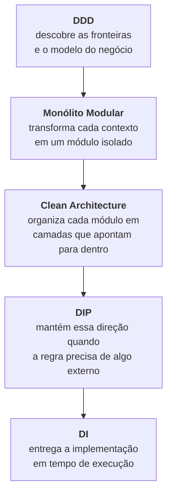

| Conceito | Natureza | Pergunta que responde | Onde atua |
| --- | --- | --- | --- |
| **DDD** | Abordagem de modelagem | Quais partes o negócio tem, onde ficam as fronteiras e que linguagem cada uma usa? | Negócio e modelo |
| **Monólito Modular** | Estilo de sistema | Como essas partes convivem num único sistema sem se misturar? | Sistema inteiro |
| **Clean Architecture** | Estilo de organização | Dentro de cada parte, o que pode depender do quê? | Dentro de cada módulo |
| **DIP** | Princípio de design | Como uma regra usa um recurso técnico sem depender dele? | Fronteiras entre camadas e módulos |
| **DI** | Mecanismo | Quem cria os objetos e entrega a cada um as suas dependências? | Tempo de execução |

Uma observação vale para todo o documento: **nenhum desses conceitos é uma estrutura de pastas.** As pastas são a parte visível das decisões. É possível ter `domain/`, `application/`, `infrastructure/` e `presentation/` e violar todas as regras. O que define a arquitetura é a direção das dependências e o lugar de cada responsabilidade. As próximas seções seguem a ordem do diagrama.

---

## 3. DDD: descobrindo as fronteiras

### 3.1. O que é

O Domain-Driven Design foi proposto por Eric Evans em 2003. A premissa é que, em sistemas com regras complexas, a parte mais difícil não é a tecnologia, e sim entender e representar corretamente o domínio. Por isso o código deve refletir um modelo do negócio construído junto com quem o conhece.

O DDD tem uma parte **estratégica**, que divide o domínio em partes com fronteiras claras, e uma parte **tática**, que modela o interior de cada parte com entidades, value objects, agregados e repositórios. A estratégica é a mais importante: aplicar só a tática produz código com cara de DDD e sem os benefícios.

### 3.2. Linguagem ubíqua e bounded contexts

A **linguagem ubíqua** é o vocabulário comum entre negócio e código. Se o negócio diz "liberar a carga", o código tem uma operação com esse significado, como `release()`, e não algo genérico como `updateStatus(5)`. Como o código do Quimovia está em inglês e a documentação em português, a regra é manter um glossário com correspondência um para um (documento 02) e usar **um único nome para cada conceito**.

Só que um mesmo termo pode significar coisas diferentes em partes diferentes do negócio. Por isso todo modelo vale dentro de uma fronteira, o **bounded context** (contexto delimitado). Veja o que "usuário" significa em três contextos do Quimovia:

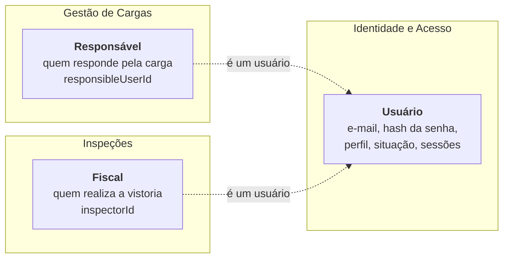

Responsável e fiscal são agentes diferentes do negócio, com papéis próprios: um responde pela carga, o outro a vistoria. Ambos, porém, são usuários do sistema. Identidade e Acesso conhece todo usuário com as suas credenciais, perfil e sessões; Gestão de Cargas só precisa saber quem é o responsável por cada carga, e Inspeções, quem é o fiscal de cada vistoria. Uma única classe `User` servindo aos três contextos viraria um modelo enorme, que todos alteram e ninguém controla. Com contextos delimitados, cada um modela apenas o papel que lhe interessa e se refere ao usuário pelo identificador, e as traduções acontecem na fronteira. O mesmo vale para "produto": no catálogo, ele tem número ONU, classe de risco e grupo de compatibilidade; numa carga, importa o item (qual produto, quanto, em que embalagem).

Um bounded context não é uma entidade, uma tabela nem uma pasta. No Quimovia, decidimos que **cada contexto vira um módulo** (seção 4), mas a fronteira é conceitual antes de ser física.

### 3.3. Os contextos do Quimovia

| Contexto | Responsabilidade | Conceitos centrais | Subdomínio |
| --- | --- | --- | --- |
| **Gestão de Cargas** | Ciclo de vida da carga química, do registro à liberação ou bloqueio | Carga, itens, composição, situação, responsável | Principal: é o que diferencia o sistema |
| **Produtos Químicos** | Catálogo de produtos e suas características de risco | Produto, número ONU, classe de risco, compatibilidade | Suporte |
| **Conformidade Documental** | Documentos exigidos, validade e parecer | Documento, exigência, parecer | Suporte, próximo do principal |
| **Inspeções** | Vistoria física da carga ou de um item | Inspeção, verificações, resultado, fiscal | Suporte, próximo do principal |
| **Identidade e Acesso** | Usuários, perfis, autenticação e sessões | Usuário, perfil, sessão | Genérico |

A classificação orienta o investimento: o subdomínio principal recebe a modelagem mais cuidadosa; um genérico pode seguir padrões conhecidos. Conformidade e Inspeções ficam próximos do principal porque alimentam a decisão de liberar ou bloquear a carga.

O **mapa de contextos** mostra como eles se relacionam. Cada seta vai do fornecedor (*upstream*) para o consumidor (*downstream*) da informação:

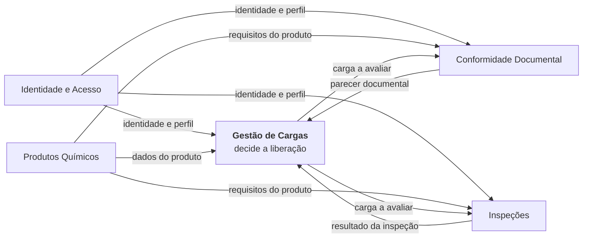

O mapa é uma visão de negócio. Os mecanismos técnicos dessa comunicação (contratos publicados, eventos) são definidos no documento 02.

### 3.4. Blocos táticos e agregados

Dentro de cada contexto, o modelo é construído com blocos táticos. Nenhum é obrigatório: cada um é usado quando existe a regra ou a necessidade que ele resolve.

| Bloco | O que é | Exemplo no domínio |
| --- | --- | --- |
| **Entidade** | Objeto com identidade e ciclo de vida; igual a outra se tem o mesmo ID | Inspeção, Usuário, Sessão |
| **Value Object** | Objeto definido pelos valores, imutável e autovalidado | Item de inspeção, número ONU, quantidade |
| **Agregado** | Grupo tratado como unidade de consistência, acessado pela raiz | Inspeção com seus itens |
| **Serviço de domínio** | Regra que envolve vários objetos e não pertence a nenhum | Compatibilidade entre produtos de uma carga |
| **Repositório** | Abstração de uma coleção de agregados (buscar, salvar) | Repositório de inspeções |
| **Evento de domínio** | Fato relevante que já aconteceu, nomeado no passado | Inspeção concluída |
| **Erro de domínio** | Violação de uma regra, sem nenhuma noção de HTTP | Inspeção concluída não pode ser alterada |

O **agregado** é o bloco mais importante, porque é ele que garante as **invariantes**, as regras que precisam ser verdadeiras sempre. "Uma inspeção só é concluída quando todas as verificações têm resultado" só pode ser garantida se toda alteração passar pela raiz:

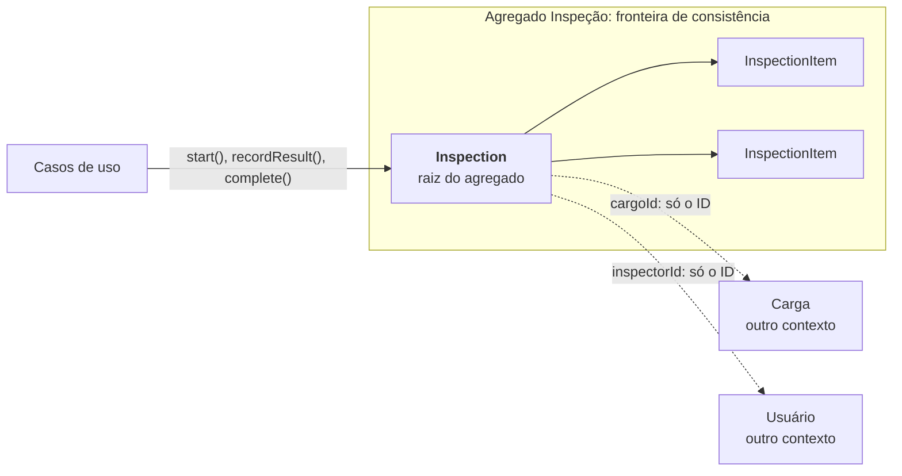

O diagrama resume as quatro orientações de desenho: o agregado **protege as invariantes** pela raiz; é **pequeno**, contendo só o que muda junto; **referencia outros agregados pelo ID**, e não pelo objeto, o que evita carregar grafos enormes e permite que o outro agregado viva em outro contexto, banco ou serviço; e, como padrão, **uma transação altera um agregado**, com a consistência entre agregados obtida por orquestração ou eventos.

As entidades distinguem duas formas de criação: `create()` cria um objeto novo, validando e aplicando as regras de nascimento (toda inspeção nasce pendente); `restore()` reconstrói um objeto persistido, sem revalidar, porque o estado era válido quando foi salvo.

### 3.5. Modelo rico e modelo anêmico

Num **modelo anêmico**, a entidade é um conjunto de dados com getters e setters, e as regras ficam espalhadas por quem a altera. Num **modelo rico**, o estado é privado e só muda por métodos que expressam intenções do negócio:

```ts
// Anêmico: qualquer código pode colocar a carga em qualquer situação
shipment.status = 'RELEASED';

// Rico: a entidade decide se a transição é permitida
shipment.release(); // lança BusinessRuleError se a carga não puder ser liberada
```

No modelo anêmico, cada lugar que altera a situação precisa lembrar de verificar a regra, e com o tempo ela é duplicada, esquecida ou aplicada de formas diferentes. No modelo rico, a regra tem um único lugar e não pode ser contornada.

Vale fechar com o que DDD **não** é: não é criar pastas `entities/` e `value-objects/`, não é um módulo por tabela, não exige todos os padrões táticos (um cadastro sem regras pode ter um modelo simples) e não é só sobre código, e sim sobre construir um modelo compartilhado com quem entende do negócio.

---

## 4. Monólito Modular: contextos como módulos

### 4.1. O que é

Definidas as fronteiras, falta decidir como os contextos convivem no sistema. Um **monólito modular** é **um único sistema implantável** (um processo, uma imagem, um banco), dividido internamente em **módulos com fronteiras explícitas**, cada um correspondente a um bounded context.

| | Monólito tradicional | Monólito modular | Microsserviços |
| --- | --- | --- | --- |
| Unidades de implantação | 1 | 1 | Várias |
| Fronteiras entre áreas | Implícitas ou inexistentes | Explícitas no código | Explícitas pela rede |
| Comunicação | Qualquer chamada direta | Contratos públicos, em memória | Rede (HTTP, mensageria) |
| Banco de dados | Compartilhado, sem dono | Compartilhado, com dono por tabela | Um por serviço |
| Consistência | ACID em qualquer lugar | ACID no contexto; entre contextos, por contrato | Eventual entre serviços |
| Custo operacional | Baixo | Baixo | Alto |
| Risco típico | Código emaranhado | Fronteiras se deteriorarem sem verificação | Monólito distribuído |

É o estilo adequado ao Quimovia porque há um produto, um time e um pipeline, sem necessidade de implantar partes separadamente. Além disso, o domínio ainda está sendo descoberto (dois dos cinco contextos não foram implementados), e mover uma fronteira dentro de um monólito é uma refatoração, enquanto movê-la entre microsserviços envolve migração de dados e de contratos de rede. Liberação e bloqueio de cargas também se beneficiam de transações locais.

### 4.2. O que torna um monólito realmente modular

Dividir o código em pastas não basta. Cada módulo expõe uma **API pública** pequena e esconde todo o resto, inclusive as próprias tabelas:

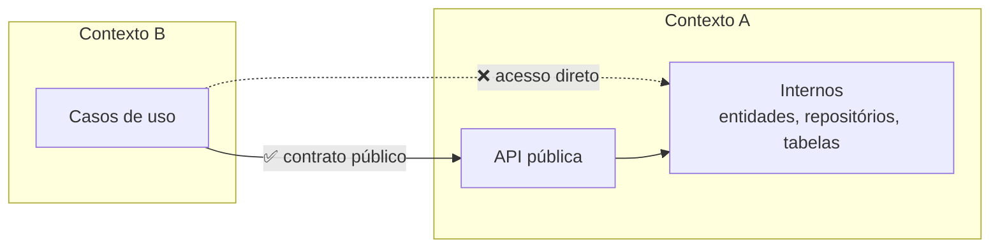

Disso decorrem cinco regras: **encapsulamento** (só a API pública é acessível), **dados com dono** (cada tabela pertence a um único módulo, que é o único a lê-la e alterá-la), **comunicação por contrato** (consultas à API pública ou eventos, nunca entidades, repositórios ou tabelas de outro módulo), **ausência de ciclos** entre módulos e **verificação automática**. A última é essencial em TypeScript, onde qualquer arquivo consegue importar qualquer outro: sem um teste que verifique as fronteiras, elas se deterioram aos poucos, sem que ninguém perceba.

### 4.3. Evolução para microsserviços

Um monólito modular **pode** facilitar a extração de microsserviços, mas isso não é automático. O benefício só existe se as condições abaixo forem verdadeiras para o contexto extraído:

| Condição | O que acontece se não for cumprida |
| --- | --- |
| Nenhum outro módulo importa os internos do contexto | A extração exige reescrever os consumidores |
| Não há leitura de tabelas alheias, *join* ou navegação entre contextos | O banco não pode ser separado sem reescrita |
| A comunicação usa contratos assíncronos com dados serializáveis, nunca entidades | Objetos em memória não atravessam a rede |
| Nenhuma transação envolve tabelas de dois contextos | Seria preciso substituí-la por compensações (sagas) |
| O negócio aceita consistência eventual onde a comunicação ficar assíncrona | A extração mudaria o comportamento do sistema |
| Há infraestrutura para operar vários serviços (pipeline, logs correlacionados, rastreamento, versionamento de contratos) | O custo operacional supera o benefício |

Há também uma mudança de comportamento a prever: uma chamada em memória nunca falha por causa da rede, mas uma chamada HTTP pode demorar, falhar ou ser repetida, e o consumidor passa a precisar de timeouts, novas tentativas e idempotência.

Motivos legítimos para extrair um contexto são escalar uma parte de forma diferente (por exemplo, processamento pesado de documentos), isolar falhas, dar a um time um ciclo de entrega próprio ou atender a uma exigência de isolamento. "Microsserviços são modernos" não é motivo. O anti-padrão a evitar é o **monólito distribuído**: serviços separados pela rede, mas implantados juntos, chamando uns aos outros em cadeia e compartilhando o banco. É o resultado típico de separar um sistema cujas fronteiras nunca foram respeitadas.

---

## 5. Clean Architecture: organizando cada módulo

### 5.1. A regra de dependência

Com os módulos definidos, resta organizar o interior de cada um. A Clean Architecture, descrita por Robert C. Martin, separa **políticas** (as regras de negócio) de **detalhes** (framework web, banco, ORM, formato de token) com uma única regra:

> As dependências do código-fonte apontam sempre para dentro, em direção às políticas. Nada que está num círculo interno conhece algo de um círculo externo.

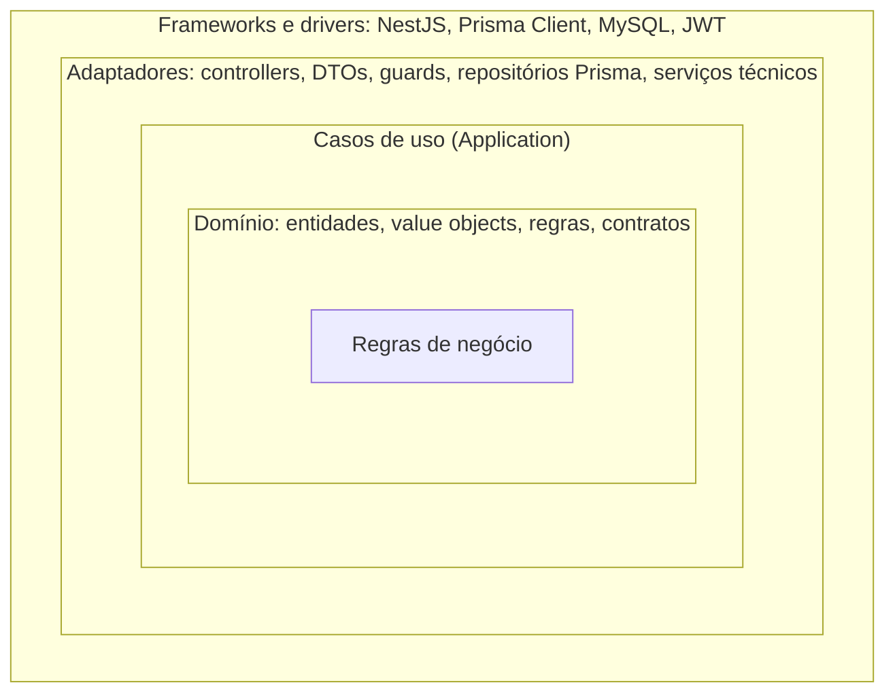

O que está dentro muda por motivos de negócio; o que está fora, por motivos técnicos. Se o domínio dependesse do Prisma, uma atualização do Prisma poderia quebrar regras de negócio. Com a dependência apontando para dentro, trocar o Prisma afeta só o círculo externo.

### 5.2. As quatro camadas adotadas

Cada módulo do projeto se organiza em quatro camadas, que correspondem aos círculos:

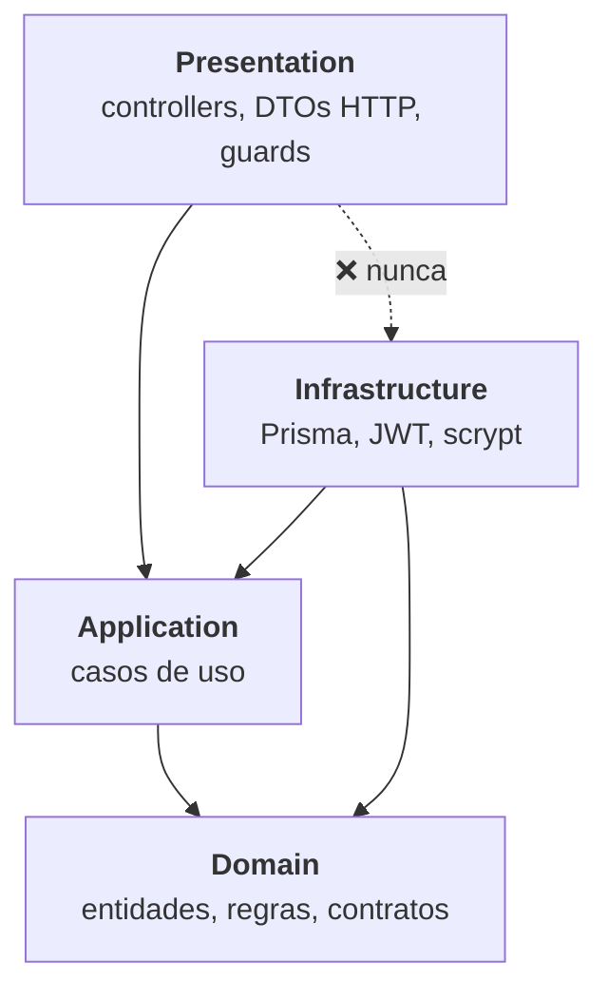

| Camada | Responsabilidade | Pergunta-teste |
| --- | --- | --- |
| **Domain** | Regras e invariantes do negócio, contratos de repositório | Esta regra continuaria existindo se trocássemos o NestJS, o HTTP e o banco? |
| **Application** | Orquestrar uma ação: buscar, acionar o domínio, salvar, coordenar recursos | Isto descreve uma ação pedida por um usuário ou por outro sistema? |
| **Presentation** | Traduzir HTTP em chamadas de caso de uso e o resultado de volta em HTTP | Isto só existe porque a API é HTTP? |
| **Infrastructure** | Implementar, com uma tecnologia, os recursos que as camadas internas pedem | Isto é o "como" técnico de algo que a regra pediu? |

Presentation e Infrastructure estão no mesmo círculo: ambas são adaptadores. A primeira **aciona** a aplicação (entrada); a segunda **é acionada** por ela (saída). Por isso um controller não chama um repositório Prisma diretamente: são vizinhos que só se encontram por meio da aplicação. Regras que dependem de dados externos ao agregado, como "o e-mail não pode estar em uso", ficam na aplicação, porque o agregado sozinho não consegue verificá-las.

Nessa organização, a abstração que a regra usa é chamada de **porta** (um contrato definido pelo lado de dentro), e a implementação técnica, de **adaptador**. Os termos vêm da Arquitetura Hexagonal, de Alistair Cockburn, muito próxima da Clean Architecture. No projeto, as portas de persistência se chamam *repositórios* e as demais, *contratos*.

### 5.3. O fluxo de uma requisição: execução e dependências

O ponto que mais confunde quem começa é que **a ordem das chamadas não é a direção das dependências**. Em execução, a requisição percorre todas as camadas até o banco (exemplo ilustrativo, a conclusão de uma inspeção):

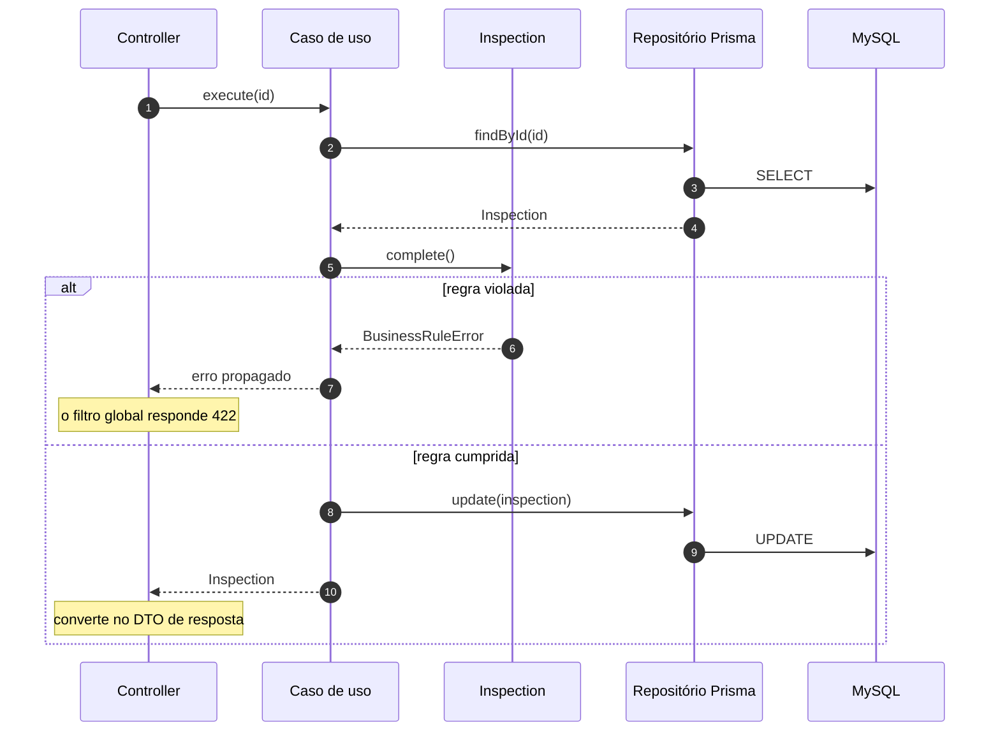

No código, porém, nada do domínio ou da aplicação importa o Prisma. O caso de uso conhece apenas uma interface, e é o repositório Prisma que depende dela:

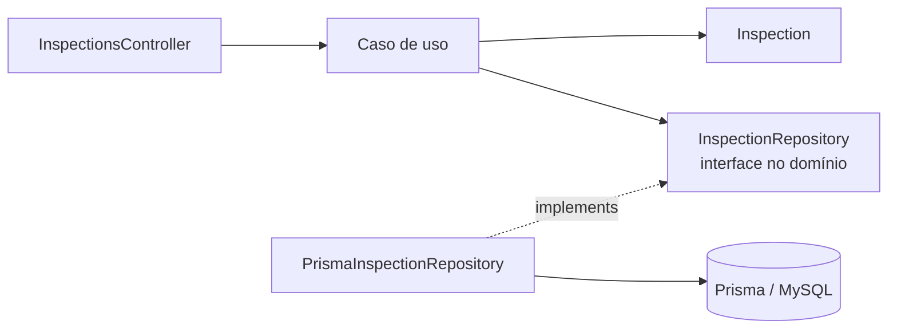

Como o domínio lança `BusinessRuleError`, e não uma exceção HTTP, o mesmo caso de uso pode ser acionado por HTTP, por uma fila ou por uma tarefa agendada sem alteração. Só a borda muda.

### 5.4. Dois tipos de validação

A separação em camadas também distingue dois tipos de validação, que podem verificar o mesmo campo sem que isso seja duplicação:

| | Validação de formato | Validação de regra de negócio |
| --- | --- | --- |
| Pergunta | "É um texto? Um inteiro? Está presente?" | "Esta transição é permitida? Todas as verificações têm resultado?" |
| Onde fica | Presentation, nos DTOs HTTP | Domínio, nas entidades e value objects |
| Protege | A borda contra dados malformados | As invariantes, venha a chamada de onde vier |
| Resultado | Resposta 400 | Erro de domínio, traduzido para 422, 404 ou 409 |

O DTO garante que `compositionVersion` é um número inteiro; o domínio garante que ela é maior ou igual a 1, mesmo que o caso de uso seja chamado por outro meio que não o HTTP.

### 5.5. Pragmatismo: onde o framework pode aparecer

Isolar completamente o NestJS exigiria registrar cada caso de uso com fábricas manuais, sem decorators de injeção: custo alto, benefício pequeno. O projeto adota um limite claro:

| Camada | Uso do NestJS | Justificativa |
| --- | --- | --- |
| Domain | **Proibido** | A regra precisa ser testável e portátil sem framework |
| Application | **Somente** `@Injectable()`, `@Inject()` e `Logger` | Metadados de composição e log não alteram o comportamento da regra |
| Presentation e Infrastructure | Livre | São a borda HTTP e os detalhes técnicos |

Se o projeto deixasse o NestJS, essas linhas de decorators mudariam, mas a lógica dos casos de uso não. Exceções HTTP como `BadRequestException` **não** fazem parte da exceção: elas levam a semântica do protocolo para dentro da aplicação.

Note também o que a Clean Architecture **não** é: não é ter as quatro pastas (um arquivo de domínio que importa `@nestjs/*` ou os modelos do Prisma viola a regra, qualquer que seja a pasta), nem criar uma interface para cada classe. As abstrações existem nas fronteiras com detalhes técnicos, e é exatamente aí que entra o próximo princípio.

---

## 6. Inversão de Dependência (DIP)

### 6.1. O princípio

A regra de dependência da seção 5 tem um problema aparente: o caso de uso **precisa** salvar no banco, mas não pode depender do banco. O Princípio da Inversão de Dependência, o "D" do SOLID, resolve esse conflito:

> a) Módulos de alto nível não devem depender de módulos de baixo nível. Ambos devem depender de abstrações.
>
> b) Abstrações não devem depender de detalhes. Detalhes devem depender de abstrações.

**Alto nível** é política (regras e casos de uso); **baixo nível** é mecanismo (Prisma, JWT, scrypt, clientes HTTP). Compare as duas situações:

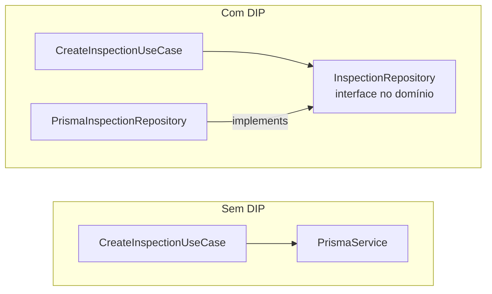

Sem DIP, o caso de uso conhece o formato das tabelas, só é testável com um banco ou uma imitação da API do Prisma, e qualquer troca de ORM o altera. Com DIP, a seta da infraestrutura aponta para dentro, **contra** o fluxo de controle. É isso que "inverter a dependência" significa.

### 6.2. A inversão no código

```ts
// domain/repositories/inspection.repository.ts — a abstração pertence ao domínio
export interface InspectionRepository {
  create(inspection: Inspection): Promise<Inspection>;
  findById(id: string): Promise<Inspection | null>;
}
export const INSPECTION_REPOSITORY = Symbol('InspectionRepository');

// application/use-cases/create-inspection.use-case.ts — depende só da abstração
export class CreateInspectionUseCase {
  constructor(
    @Inject(INSPECTION_REPOSITORY)
    private readonly inspections: InspectionRepository,
  ) {}
}

// infrastructure/persistence/prisma/prisma-inspection.repository.ts — o detalhe implementa a abstração
export class PrismaInspectionRepository implements InspectionRepository { /* ... */ }
```

### 6.3. Uma boa abstração

A abstração pertence **a quem a usa**: fica junto do domínio ou da aplicação, escrita na linguagem deles. Se a interface fica na pasta da infraestrutura, ao lado do Prisma, ou é gerada a partir dele, existe uma interface, mas não existe inversão. Ela também não pode vazar o detalhe que deveria esconder:

```ts
// Vaza o detalhe: a porta expõe tipos do Prisma
list(args: Prisma.InspectionFindManyArgs): Promise<InspectionModel[]>;

// Fala a linguagem do domínio
list(filters: InspectionSearchFilters): Promise<InspectionPage>;
```

Uma boa porta não usa tipos do ORM nem de bibliotecas, recebe e devolve objetos do domínio ou dados simples e sinaliza falhas com erros de domínio ou `null`. Aplique o DIP nas fronteiras com detalhes que podem mudar ou atrapalham os testes: persistência, criptografia e tokens, sistemas externos e outros contextos. **Não** o aplique entre objetos do próprio domínio, em funções puras ou em DTOs: uma interface fora de uma fronteira é só indireção.

### 6.4. DIP entre contextos

O mesmo princípio protege as fronteiras entre módulos. Se Gestão de Cargas precisa saber quem é o responsável por uma carga, ela não importa o repositório nem a entidade de Identidade e Acesso: depende de uma **abstração**, e a implementação fica do outro lado.

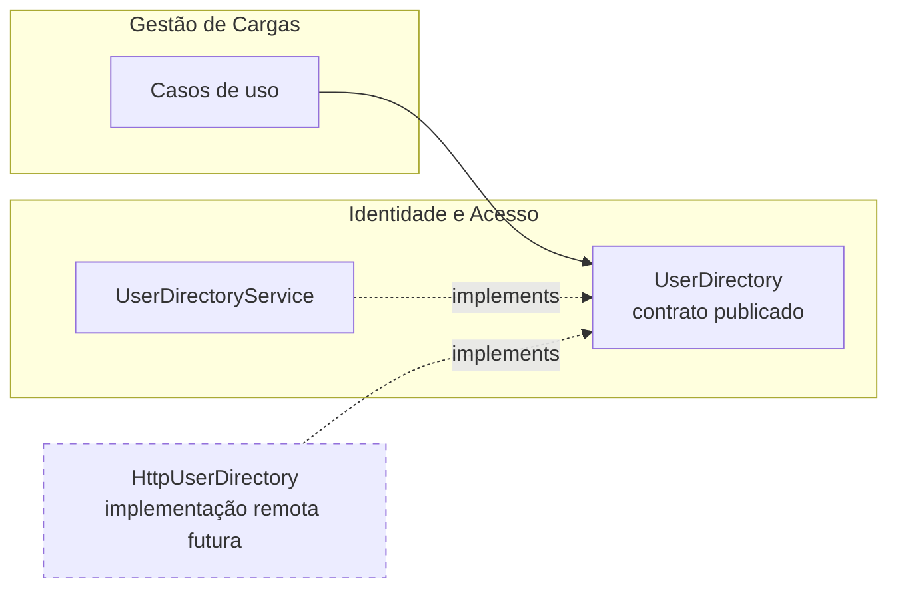

Há duas formas de definir essa abstração:

| Forma | Quem define o contrato | Quando usar |
| --- | --- | --- |
| **Contrato publicado** | O fornecedor publica uma interface e um token na sua API pública; o consumidor injeta pelo token | Quando os dados publicados servem ao consumidor como estão. É a forma padrão no projeto |
| **Porta do consumidor** | O consumidor define a interface na sua linguagem e um adaptador traduz o contrato do fornecedor | Quando o modelo do fornecedor precisa ser traduzido. O adaptador funciona como uma camada anticorrupção |

Nas duas, o caso de uso consumidor depende só de uma interface. Se o fornecedor for extraído para outro serviço, basta registrar uma implementação remota para o mesmo contrato, como no nó tracejado do diagrama, e os casos de uso não mudam. No projeto, Gestão de Cargas usa o contrato `UserDirectory` publicado por Identidade e Acesso (documento 02, seção 5.2). Não há porta do consumidor porque os dados publicados servem como estão, e um adaptador só repassaria chamadas.

O DIP define **para onde** apontam as dependências. Falta decidir **quem** cria a implementação concreta e a entrega ao caso de uso.

---

## 7. Injeção de Dependência (DI)

### 7.1. A técnica

Injeção de dependência é a técnica em que um objeto **recebe** as suas dependências de fora, em vez de criá-las com `new` ou buscá-las numa variável global. A forma preferida é a injeção **por construtor**: as dependências ficam explícitas na assinatura, podem ser `readonly`, e o objeto nunca existe sem uma dependência obrigatória.

```ts
// Sem DI: a classe escolhe e cria a própria dependência
class LoginUseCase {
  private readonly hasher = new ScryptPasswordHasher();
}

// Com DI: alguém de fora entrega a dependência
class LoginUseCase {
  constructor(private readonly hasher: PasswordHasher) {}
}
```

O lugar onde os objetos concretos são criados e ligados é a **raiz de composição** (*composition root*). DI não exige framework: num teste unitário, o próprio teste é a raiz de composição (`new CreateInspectionUseCase(new InspectionRepositoryMock())`). Na aplicação, essa ligação é automatizada por um **container de DI**, que no Quimovia é o do NestJS.

### 7.2. DI no NestJS

O container do NestJS trabalha com **providers** (o que ele sabe criar), identificados por **tokens** e organizados em **módulos**. Quando um caso de uso pede uma dependência, a resolução acontece assim:

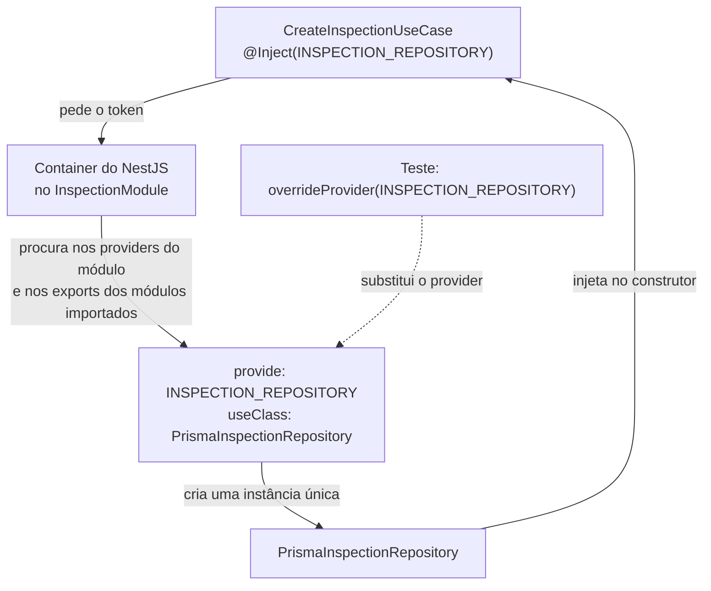

Alguns detalhes tornam esse mecanismo compatível com o DIP:

- **Tokens.** Interfaces TypeScript não existem em tempo de execução, então não podem ser tokens. Por isso cada contrato exporta um `Symbol` como token, e o consumidor declara `@Inject(TOKEN)`. Ferramentas que não emitem metadados de tipo, como o `tsx` usado em desenvolvimento, exigem `@Inject` também para classes.
- **Formas de registro.** A classe pode registrar a si mesma (`providers: [CreateInspectionUseCase]`) ou um token pode apontar para uma classe (`useClass`), um valor pronto (`useValue`) ou o resultado de uma função, que recebe outros providers por `inject` (`useFactory`).
- **Escopo.** Por padrão, cada provider é um *singleton*. Por isso casos de uso e repositórios não guardam estado entre chamadas.
- **Encapsulamento.** Os `providers` de um módulo são privados; só o que ele lista em `exports` pode ser injetado por quem o importa. É isso que permite alinhar os módulos do NestJS aos bounded contexts. O NestJS, porém, controla o que pode ser **injetado**, não o que pode ser **importado** pelo TypeScript, e essa parte da fronteira precisa de convenção e de teste automático. `@Global()` torna os exports visíveis em toda a aplicação e esconde dependências; o projeto prefere declará-las.
- **Falha rápida.** Uma dependência não resolvida faz a aplicação falhar ao iniciar, com o nome do provider e do módulo, e não no meio de uma requisição.
- **Guards.** Um guard usado em `@UseGuards(AuthGuard)` é resolvido no módulo do controller que o usa, então as dependências dele precisam estar disponíveis ali.

Como os consumidores dependem de tokens, e não de classes, o mesmo módulo pode ser testado com outra implementação (o nó `TEST` do diagrama), sem que o código de produção saiba que está sendo testado.

### 7.3. DIP e DI: complementares, não equivalentes

| | DIP | DI |
| --- | --- | --- |
| Natureza | Princípio de design | Técnica, apoiada por um mecanismo |
| Pergunta | Para onde apontam as dependências no código? | Quem cria e entrega as dependências em execução? |
| Atua em | Imports, interfaces, desenho dos contratos | Instâncias, ciclo de vida, ligação entre objetos |
| Um sem o outro | **DIP sem DI:** o caso de uso depende da interface, e a ligação é feita à mão com `new`. Funciona | **DI sem DIP:** o NestJS injeta `PrismaService` direto no caso de uso. Há injeção, mas a regra depende do detalhe |

Juntos, o DIP define a abstração e a direção, e a DI liga a implementação concreta à abstração sem que o consumidor saiba qual é. Em resumo: **usar o NestJS não significa aplicar DIP.**

---

## 8. Como os conceitos trabalham juntos

DDD, Monólito Modular, Clean Architecture e DIP são **decisões e princípios**; DI e os módulos do NestJS são **mecanismos** que os implementam. Um mecanismo sem o princípio produz estrutura sem benefício, como módulos que exportam tudo para todos. O diagrama mostra o que cada conceito produz no exemplo da conclusão de uma inspeção:

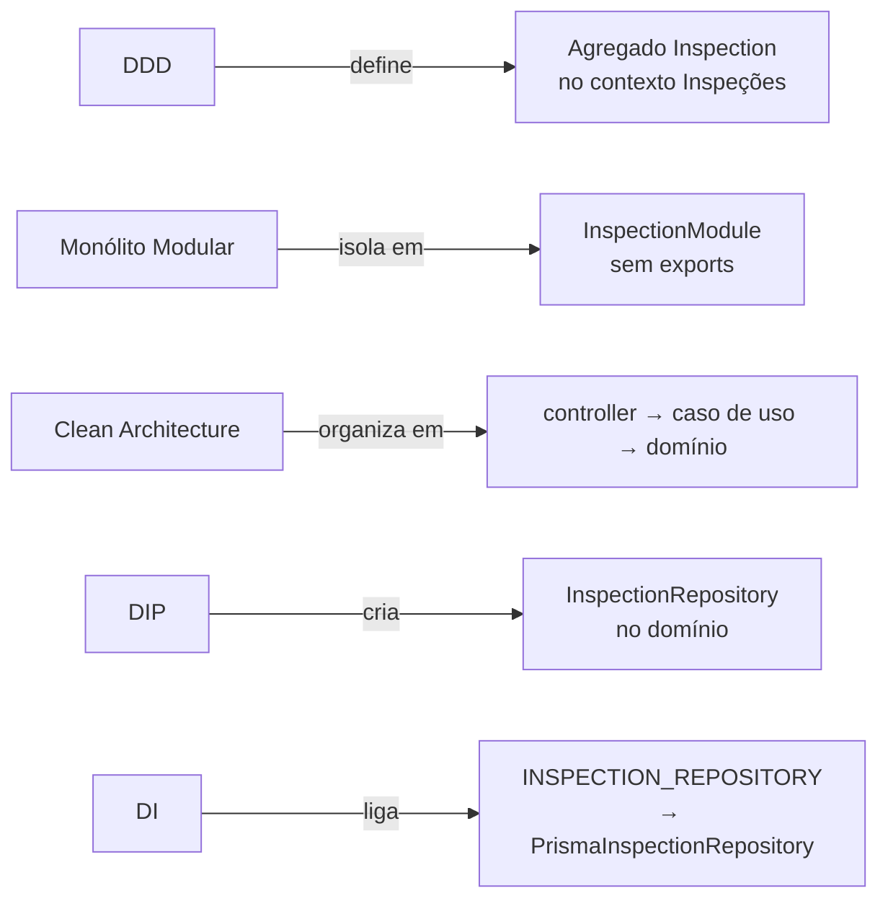

A regra "só conclui com todas as verificações registradas" pertence ao agregado, e Gestão de Cargas só precisa do resultado, por isso os contextos se referem à carga pelo ID. O módulo de Inspeções não expõe entidade nem repositório, então o resultado chega a outros contextos por contrato ou evento. O controller chama o caso de uso, que chama `inspection.complete()` e salva pelo contrato do repositório. O contrato está no domínio e a implementação Prisma depende dele. Por fim, o módulo registra o provider que liga os dois: em produção o caso de uso recebe o repositório Prisma; no teste, um fake, sem nenhuma mudança no código.

| Conceito | Sem ele |
| --- | --- |
| DDD | Módulos por tabela ou tecnologia; termos ambíguos |
| Monólito Modular | Contextos acessam os internos uns dos outros; separação futura inviável |
| Clean Architecture | Regras dependentes de framework e banco |
| DIP | A regra de dependência é impossível sempre que o fluxo vai para fora |
| DI | `new` espalhado pelas regras; testes que dependem de infraestrutura real |

---

## 9. A arquitetura na stack do projeto

| Tecnologia | Papel na arquitetura | Cuidado |
| --- | --- | --- |
| **NestJS** | Módulos são as raízes de composição dos contextos; providers são casos de uso e adaptadores; controllers, pipes, guards e filtros formam a presentation | É um detalhe: o domínio não o conhece. O padrão `XService` dos geradores tende a misturar regra, dados e HTTP; o projeto usa casos de uso com uma ação cada |
| **TypeScript** | A tipagem estrutural torna as interfaces boas portas, e `implements` verifica os adaptadores; campos `#privados` garantem o encapsulamento das entidades em execução | Interfaces somem na compilação: contratos usam tokens `Symbol`, interfaces são importadas com `import type` e tokens como valor |
| **Prisma** | Adaptador de persistência: os repositórios convertem registros em entidades e vice-versa | O client e os tipos gerados representam o esquema do banco, não o domínio, e não saem da infraestrutura. Um único client acessa todas as tabelas, então a regra de dono é verificada por convenção e testes |
| **MySQL** | Transações ACID e integridade referencial | Dentro de um contexto, chaves estrangeiras e transações são usadas normalmente; entre contextos, uma chave estrangeira acopla o armazenamento e é exceção (D8) |
| **Jest** | Cada camada define o que o teste precisa: domínio puro sem mocks, casos de uso com fakes, adaptadores com fakes ou banco real, rotas HTTP com providers substituídos | Fakes do Prisma verificam as chamadas, não o SQL: os adaptadores ainda precisam de testes de integração |

---

## 10. Decisões arquiteturais e trade-offs

| # | Decisão | Por quê | Custo |
| --- | --- | --- | --- |
| D1 | Monólito modular, e não microsserviços | Um time, um produto e um domínio em descoberta (seção 4.1) | O sistema escala como um todo; extrair um contexto exige as condições da seção 4.3 |
| D2 | Módulos alinhados aos bounded contexts | O que muda junto fica junto: a fronteira do negócio é a do código | Uma fronteira errada custa uma refatoração |
| D3 | Quatro camadas por contexto, com dependências para dentro | Regras independentes de tecnologia e testáveis isoladamente | Mais arquivos e indireção nas fronteiras |
| D4 | Domínio sem framework; aplicação só com decorators de DI e `Logger` | Equilíbrio entre pureza e produtividade (seção 5.5) | A aplicação conhece os decorators do NestJS |
| D5 | Repositórios como contratos no domínio, implementados com Prisma na infraestrutura | Aplica o DIP onde ele mais importa: entre a regra e o banco | Mapeamento repetitivo entre modelo do Prisma e entidade |
| D6 | Tokens `Symbol` e injeção explícita com `@Inject` | Interfaces não existem em execução e o `tsx` não emite metadados de tipo | Construtores um pouco mais verbosos |
| D7 | Comunicação entre contextos só por contratos públicos e, quando necessário, eventos | Autonomia dos contextos e extração futura viável | Um *join* vira duas consultas; contratos precisam ser mantidos |
| D8 | Um banco, com dono por tabela e referência por ID entre contextos; chave estrangeira entre contextos só como exceção documentada, sem cascata e sem navegação no código | Integridade dentro do contexto sem amarrar o armazenamento entre contextos | Fora das exceções, a integridade entre contextos é responsabilidade da aplicação |
| D9 | Erros de domínio sem semântica HTTP, traduzidos na borda | O mesmo caso de uso serve a HTTP, filas ou tarefas agendadas | Um filtro global mapeia cada erro para um código HTTP |
| D10 | Simplicidade primeiro: padrões, interfaces e pastas só onde há necessidade concreta | Abstração sem necessidade é custo sem benefício | Exige julgamento caso a caso e revisão |

A prioridade que orienta D10 é: **clareza** acima de abstração, **manutenibilidade** acima de elegância teórica, **domínio** acima de framework e **modularidade** acima de organização técnica genérica.

Os ganhos dessas decisões não são automáticos. Cada um depende de uma condição:

| Dimensão | Ganho | Condição | Custo ou limitação |
| --- | --- | --- | --- |
| Desenvolvimento | Lugar previsível para cada código; trabalho paralelo em contextos diferentes | Convenções seguidas e revisadas | Mais arquivos; curva de aprendizado |
| Testabilidade | Domínio sem infraestrutura; casos de uso com fakes | Contratos bem definidos e domínio sem framework | Manter os fakes; adaptadores ainda precisam de integração |
| Manutenção | Mudanças localizadas: regra no domínio, tecnologia na infraestrutura, formato na presentation | Nenhum detalhe técnico vazando para dentro | Mapeamento repetitivo entre Prisma, domínio e DTO |
| Organização | Fronteiras explícitas e linguagem consistente | Glossário mantido e fronteiras verificadas | Sem verificação, a erosão é silenciosa |
| Escalabilidade | Possibilidade de extrair um contexto | Todas as condições da seção 4.3 | A extração tem custo operacional real |

Para um contexto que é apenas um cadastro, sem regras, a estrutura completa pode ser mais pesada do que o problema. Nesses casos, use casos de uso finos, não crie value objects ou serviços sem regra nem interfaces sem fronteira: a estrutura reflete as necessidades de cada contexto, e não é replicada vazia em todos.

---

## 11. Glossário

| Termo | Significado |
| --- | --- |
| Adaptador | Implementação de uma porta com uma tecnologia específica |
| Agregado | Grupo de objetos tratado como unidade de consistência, acessado pela raiz |
| API pública de um contexto | Contratos, tipos e providers que outros contextos podem usar |
| Bounded context | Fronteira dentro da qual um modelo e a sua linguagem são válidos |
| Camada anticorrupção | Adaptador que traduz o modelo de outro contexto para o do consumidor |
| Caso de uso | Classe que representa uma ação do sistema e orquestra domínio e portas |
| Composition root | Lugar onde os objetos concretos são criados e ligados; no projeto, os módulos do NestJS |
| Consistência eventual | Os dados ficarão consistentes, mas não necessariamente de imediato |
| Contrato | Interface que define uma dependência; no projeto, as portas que não são repositórios |
| Evento de domínio | Fato relevante do negócio que já aconteceu |
| Invariante | Regra que precisa ser verdadeira sempre |
| Linguagem ubíqua | Vocabulário comum entre negócio e código |
| Monólito distribuído | Serviços separados pela rede, mas acoplados como um monólito |
| Porta | Contrato definido pelo lado de dentro, que descreve o que a regra precisa |
| Provider | Algo que o container do NestJS sabe criar e injetar |
| Token | Identificador de um provider no NestJS |
| Value Object | Objeto definido pelos valores, imutável e autovalidado |

---

## 12. Referências

- Eric Evans. *Domain-Driven Design: Tackling Complexity in the Heart of Software*. Addison-Wesley, 2003.
- Vaughn Vernon. *Implementing Domain-Driven Design*. Addison-Wesley, 2013.
- Vaughn Vernon. *Effective Aggregate Design* (série de artigos), 2011.
- Robert C. Martin. *Clean Architecture: A Craftsman's Guide to Software Structure and Design*. Prentice Hall, 2017.
- Robert C. Martin. *The Dependency Inversion Principle*. C++ Report, 1996.
- Alistair Cockburn. *Hexagonal Architecture* (Ports and Adapters), 2005.
- Documentação do NestJS: [Modules](https://docs.nestjs.com/modules), [Providers](https://docs.nestjs.com/providers), [Custom providers](https://docs.nestjs.com/fundamentals/custom-providers).
