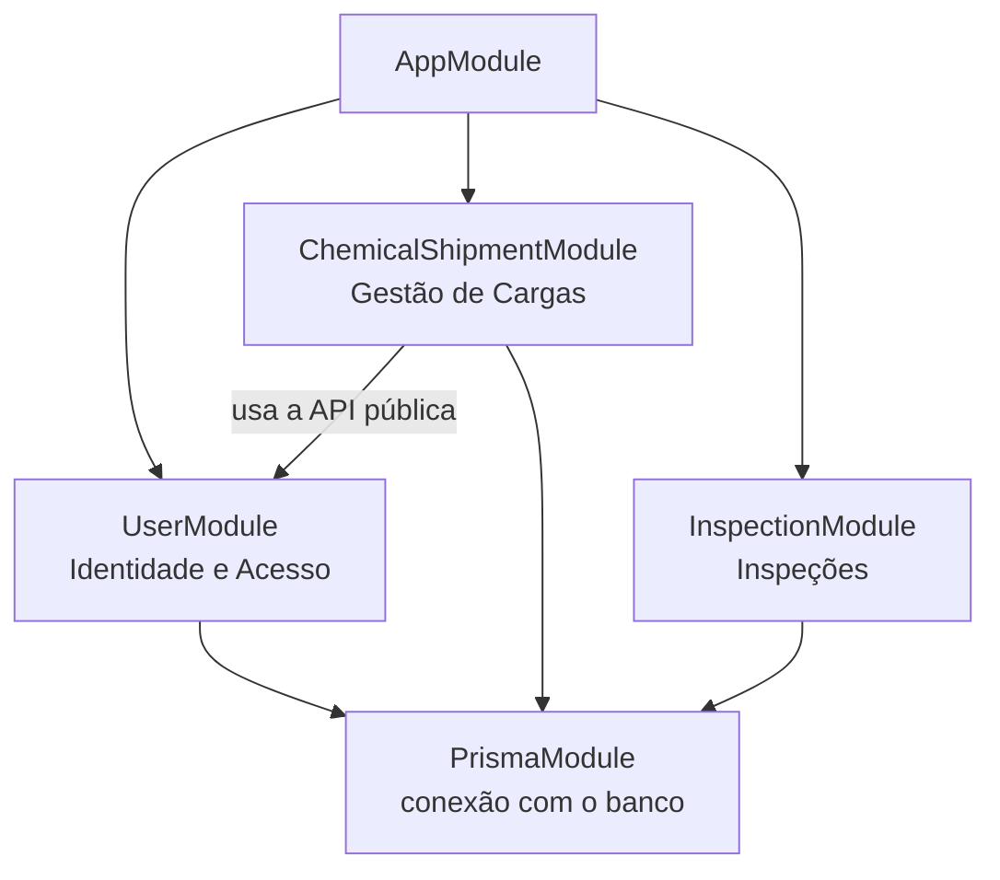
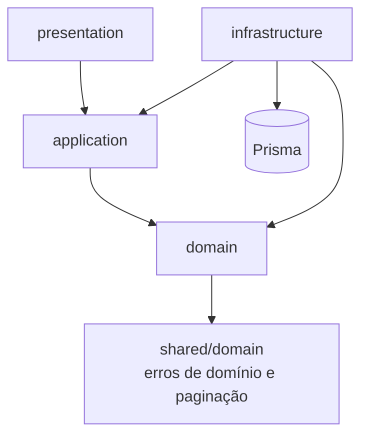
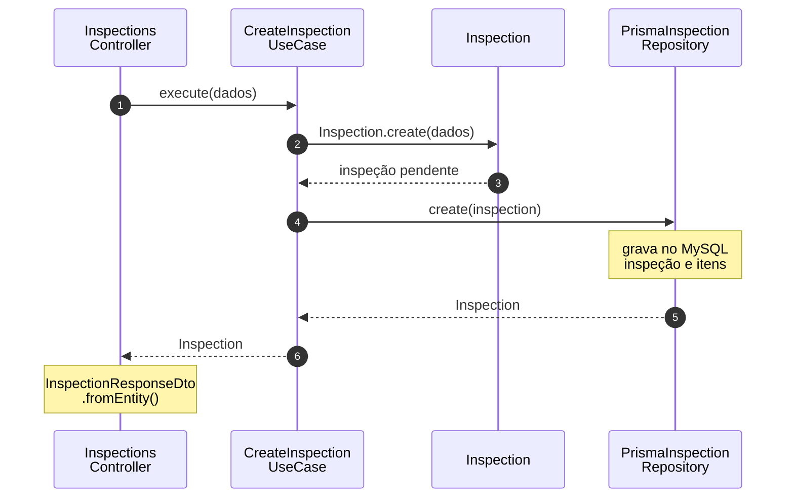
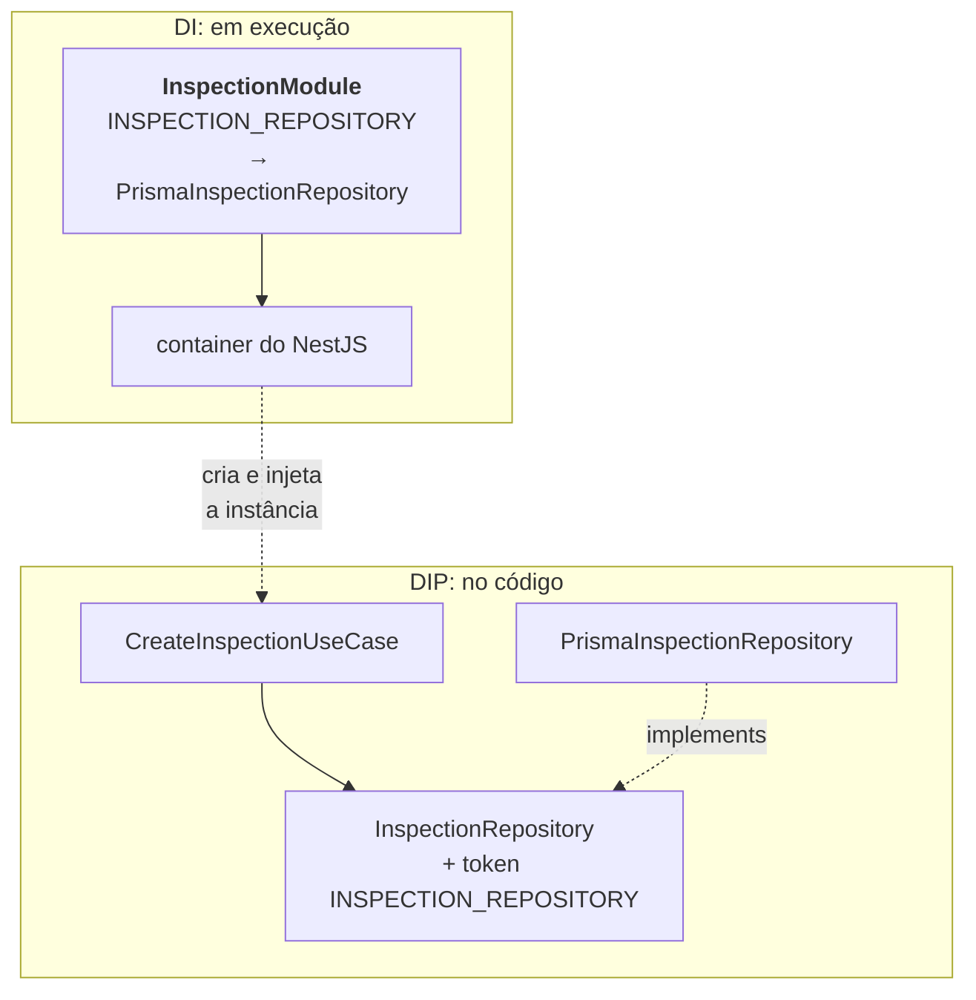
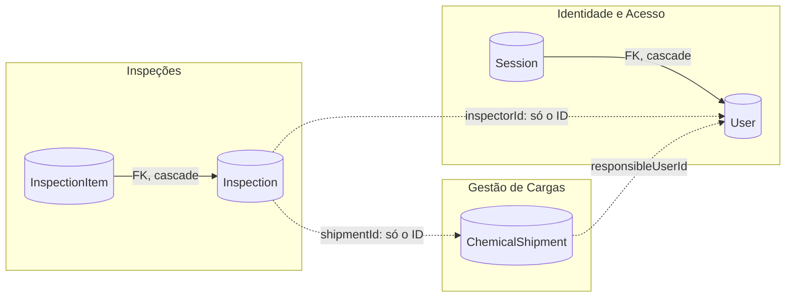
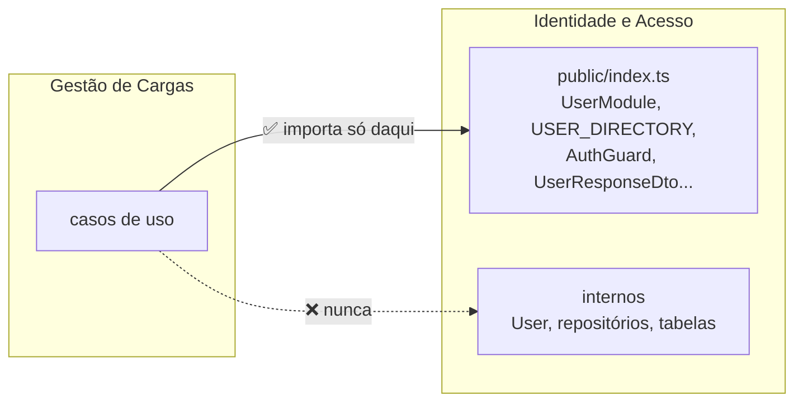
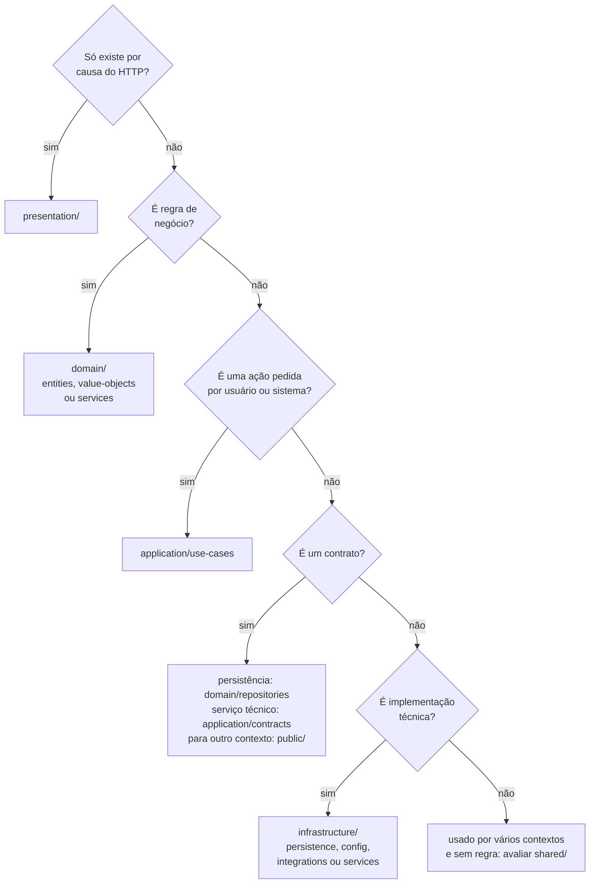

# Arquitetura do Quimovia — Guia prático de desenvolvimento

| Documento | Para que serve |
| --- | --- |
| [01 — Fundamentos e decisões](./01-fundamentos-e-decisoes.md) | Entender **o que** é a arquitetura e **por que** ela foi escolhida |
| **02 — Guia prático de desenvolvimento** (este) | Saber **como** aplicá-la no código: onde cada coisa fica, como as peças se ligam e como implementar uma funcionalidade |

Este guia é para quem conhece NestJS e TypeScript e precisa implementar funcionalidades seguindo a arquitetura do projeto. Os conceitos (DDD, Clean Architecture, Monólito Modular, DIP e DI) são explicados no documento 01. Aqui eles aparecem aplicados. Leia as seções 1 a 4 em sequência uma vez e use as seções 5 e 6 como consulta durante o desenvolvimento.

1. [Visão geral do projeto](#1-visão-geral-do-projeto)
2. [Estrutura de um contexto](#2-estrutura-de-um-contexto)
3. [Comunicação e dependências](#3-comunicação-e-dependências)
4. [Implementação prática: cadastrar uma inspeção](#4-implementação-prática-cadastrar-uma-inspeção)
5. [Persistência e integração entre contextos](#5-persistência-e-integração-entre-contextos)
6. [Boas práticas](#6-boas-práticas)

---

## 1. Visão geral do projeto

O Quimovia é um monólito modular: uma única aplicação NestJS, dividida em **contextos de domínio** isolados (documento 01, seções 3 e 4). Toda funcionalidade de negócio vive em `src/modules/`, em um diretório por contexto. O restante do repositório inicializa a aplicação, guarda o pouco que é comum a todos e testa o código:

```text
src/
├── main.ts               inicializa a aplicação: ValidationPipe, filtro de erros, Swagger
├── app.module.ts         compõe a aplicação a partir dos módulos de contexto
├── modules/              um diretório por contexto: é aqui que você vai trabalhar
├── shared/               erros de domínio, paginação, logError, banco, filtro, pipe e decorators do Swagger
└── generated/prisma/     Prisma Client gerado (não editar)
prisma/                   schema.prisma e migrations
test/                     architecture/, unit/, e2e/ e mocks/
```

| Contexto | Pasta | O que representa |
| --- | --- | --- |
| Gestão de Cargas | `chemical-shipment/` | O ciclo de vida da carga química, do registro à liberação ou bloqueio. É o núcleo do sistema |
| Inspeções | `inspection/` | A vistoria física de uma carga ou de um item, feita por um fiscal |
| Identidade e Acesso | `user/` | Usuários, perfis, sessões e autenticação |
| Produtos Químicos | ainda não implementado | O catálogo de produtos e suas características de risco |
| Conformidade Documental | ainda não implementado | Os documentos exigidos para cada carga e o parecer sobre eles |

Cada contexto tem **um único módulo NestJS**, que liga as peças do contexto e define o que ele expõe aos outros:



O `AppModule` apenas reúne os contextos. Quem grava dados importa o `PrismaModule`, e quem precisa de outro contexto importa o módulo dele **pela API pública** (seção 5). Cada contexto é dono do seu modelo: o responsável por uma carga e o fiscal de uma inspeção são agentes diferentes, ambos usuários do sistema, e cada contexto guarda apenas o ID do usuário no papel que lhe interessa.

A pasta `shared/` é pequena de propósito. Antes de colocar algo nela, pergunte: *se eu remover um contexto, este código ainda faz sentido?* Se a resposta for não, ele pertence ao contexto.

---

## 2. Estrutura de um contexto

Dentro de cada contexto, o código se divide nas quatro camadas da Clean Architecture (documento 01, seção 5), mais a API pública e o módulo. A árvore abaixo é o modelo completo, com exemplos reais. Cada pasta só é criada quando o primeiro arquivo precisa dela:

```text
src/modules/<contexto>/
├── domain/                     regras do negócio, sem NestJS nem Prisma
│   ├── entities/               inspection.entity.ts: o agregado e suas regras
│   ├── value-objects/          inspection-item.vo.ts
│   ├── enums/                  inspection-status.enum.ts
│   ├── repositories/           inspection.repository.ts: contrato de persistência + token
│   └── services/  errors/      regras entre vários objetos / erros específicos
├── application/                ações do sistema
│   ├── use-cases/<agregado>/   create-inspection.use-case.ts: um arquivo por ação
│   ├── contracts/              password-hasher.contract.ts: contratos técnicos + tokens
│   ├── dto/                    tipos compartilhados por vários casos de uso
│   └── services/               implementações de contratos publicados
├── infrastructure/             detalhes técnicos
│   ├── persistence/prisma/     prisma-inspection.repository.ts
│   └── services/  config/      jwt-access-token.service.ts / auth.config.ts
├── presentation/               borda HTTP
│   ├── controllers/            inspections.controller.ts
│   ├── dtos/                   create-inspection.dto.ts, inspection-response.dto.ts
│   └── guards/  decorators/    auth.guard.ts / current-session.decorator.ts
├── public/                     API pública para outros contextos (seção 5)
│   ├── index.ts
│   └── *.contract.ts
└── <contexto>.module.ts        liga contratos a implementações (seção 3)
```

| Camada | Responsabilidade | Não pode |
| --- | --- | --- |
| **domain** | Entidades, value objects, enums e contratos de repositório. Garante as regras que valem sempre | Importar NestJS, Prisma, outras camadas ou outro contexto |
| **application** | Casos de uso: buscar pelos contratos, acionar o domínio, salvar e devolver o resultado | Importar infraestrutura, presentation, Prisma ou exceções HTTP. Do NestJS, só `@Injectable`, `@Inject` e `Logger` |
| **infrastructure** | Implementar os contratos com uma tecnologia: Prisma, hash, JWT, configuração | Tomar decisões de negócio ou deixar tipos do Prisma escaparem |
| **presentation** | Receber a requisição, validar o formato, chamar **um** caso de uso, montar a resposta e documentar a rota no Swagger | Conter regra de negócio, tratar erros ou acessar a infraestrutura |

Duas convenções dão forma às camadas internas. As **entidades** têm estado privado (campos `#`), sem setters públicos, e só mudam por métodos com nome de negócio, como `start()` e `complete()`, que lançam `BusinessRuleError` quando algo é proibido. Elas são criadas por `create()`, que valida os dados, ou reconstruídas do banco por `restore()`, sem revalidar, e referenciam outros agregados apenas pelo ID (`shipmentId`, `inspectorId`). Os **casos de uso** têm um único método `execute`. Quando a entrada é a mesma da criação da entidade, eles reaproveitam o tipo dela (`CreateInspectionData`); nas listagens, a entrada é `Partial` dos filtros do repositório (`Partial<InspectionSearchFilters>`) e o resultado, um `Page<T>` de `shared/domain/pagination.ts`; nos demais casos, declaram o tipo de entrada no próprio arquivo. Eles também ficam com as regras que dependem de dados fora do agregado, como a unicidade de um e-mail.

A presentation e o domínio validam coisas diferentes. O DTO valida o **formato** ("é um UUID?") e responde 400. A entidade valida a **regra** ("uma inspeção de item exige o ID do item") e lança um erro de domínio, que vira 422. A validação da entidade vale mesmo quando o caso de uso não é chamado por HTTP.

---

## 3. Comunicação e dependências

Saber o que vai em cada camada é metade do trabalho. A outra metade é entender como elas se ligam, e aqui há duas perguntas diferentes: **quem pode importar quem** e **em que ordem o código executa**.

### 3.1. A direção das dependências

As setas indicam "pode importar". Todas apontam para o domínio, e só a infraestrutura conhece o Prisma:



Em execução, porém, a requisição vai do controller até o banco e passa pela infraestrutura, que a aplicação nunca importa. Veja o cadastro de uma inspeção:



Como o caso de uso chama o repositório Prisma sem importá-lo? Ele depende apenas de uma **interface** declarada no domínio, e quem depende dela é o repositório Prisma. Essa é a Inversão de Dependência (DIP). Em execução, o NestJS cria a implementação e a entrega ao caso de uso, o que é a Injeção de Dependência (DI):



### 3.2. DIP e DI no NestJS em três passos

Todo contrato do projeto segue os mesmos três passos.

**1. Declare a interface e o token**, junto de quem a usa (no domínio, para repositórios). Interfaces TypeScript não existem em execução, então o NestJS precisa de um **token**, um `Symbol` exportado no mesmo arquivo:

```ts
// domain/repositories/inspection.repository.ts
export interface InspectionRepository {
  create(inspection: Inspection): Promise<Inspection>;
  findById(id: string): Promise<Inspection | null>;
  // ...update, remove, list
}

export const INSPECTION_REPOSITORY = Symbol('InspectionRepository');
```

**2. Dependa da interface, pedindo pelo token.** A interface é importada como tipo, e o token como valor:

```ts
// application/use-cases/inspections/create-inspection.use-case.ts
import { INSPECTION_REPOSITORY } from '@/modules/inspection/domain/repositories/inspection.repository.js';
import type { InspectionRepository } from '@/modules/inspection/domain/repositories/inspection.repository.js';

constructor(
  @Inject(INSPECTION_REPOSITORY)
  private readonly inspections: InspectionRepository,
) {}
```

**3. Ligue o token à implementação no módulo.** O módulo é o único lugar que sabe qual classe implementa o contrato:

```ts
// inspection.module.ts
@Module({
  imports: [PrismaModule],
  controllers: [InspectionsController],
  providers: [
    CreateInspectionUseCase,
    // ...demais casos de uso
    { provide: INSPECTION_REPOSITORY, useClass: PrismaInspectionRepository },
  ],
})
export class InspectionModule {}
```

Ao criar o caso de uso, o NestJS procura o token nos providers do módulo e nos exports dos módulos importados, cria uma única instância de `PrismaInspectionRepository` e a injeta. Se não encontrar, a aplicação falha **ao iniciar**, com o nome do token na mensagem. Algumas regras completam o mecanismo:

- **Sempre `@Inject(...)` explícito**, inclusive para classes. O `tsx` do `npm run start:dev` não emite os metadados que permitiriam ao NestJS deduzir a dependência.
- **Crie contratos só nas fronteiras:** banco (repositório), serviços técnicos como hash e tokens (`application/contracts/`) e outros contextos (contrato publicado). Objetos do domínio, casos de uso e DTOs são usados diretamente, sem interface.
- **Um contrato fala a língua de quem o usa:** recebe e devolve entidades ou dados simples, nunca tipos do Prisma.
- **Um módulo exporta só a sua API pública** e declara as dependências em `imports`. Nada é `@Global()`.

A recompensa aparece nos testes. Como o caso de uso depende de uma interface, o teste unitário entrega um fake pelo construtor (`new CreateInspectionUseCase(new InspectionRepositoryMock())`), e o teste E2E monta o módulo real trocando só o que é externo:

```ts
await Test.createTestingModule({ imports: [InspectionModule] })
  .overrideProvider(PrismaService).useValue(createPrismaServiceStub())
  .overrideProvider(INSPECTION_REPOSITORY).useClass(InspectionRepositoryMock)
  .compile();
```

### 3.3. Como os erros atravessam as camadas

O domínio lança erros de negócio sem saber nada de HTTP. O caso de uso registra o erro com `logError(this.logger, contexto, error)` e o propaga com `throw error`, e o `DomainExceptionFilter`, registrado globalmente, o traduz na borda. Controller e repositório não capturam erros: cada erro é registrado uma vez e traduzido uma vez. Por isso o mesmo caso de uso funciona para uma requisição, uma fila ou uma tarefa agendada. Use os erros de `shared/domain/errors/domain.error.ts`:

| Erro | Quando usar | HTTP |
| --- | --- | --- |
| `BusinessRuleError` | Uma regra de negócio foi violada | 422 |
| `ResourceNotFoundError` | O recurso não existe | 404 |
| `ConflictError` | A operação conflita com um recurso existente | 409 |
| `AuthenticationError` / `AccessDeniedError` | Credencial inválida / sem permissão | 401 / 403 |

---

## 4. Implementação prática: cadastrar uma inspeção

Vamos juntar tudo acompanhando uma funcionalidade real do repositório, o `POST /inspecoes`. A ordem recomendada é de dentro para fora: primeiro a regra, por último o HTTP. Assim a parte mais importante é escrita e testada antes de qualquer detalhe técnico.

**1. Modele a regra no domínio.** Toda inspeção nasce pendente, prevê ao menos uma verificação, sem repetições, e a inspeção de um item exige o identificador do item. Essas regras ficam no `create()` da entidade, e cada `validate...` lança `BusinessRuleError`:

```ts
// domain/entities/inspection.entity.ts (trecho)
static create(data: CreateInspectionData): Inspection {
  const now = new Date();

  return new Inspection({
    id: randomUUID(),
    shipmentId: Inspection.validateIdentifier(data.shipmentId, 'da carga'),
    scope: data.scope,
    shipmentItemId: Inspection.validateShipmentItem(data.scope, data.shipmentItemId),
    inspectorId: Inspection.validateIdentifier(data.inspectorId, 'do Fiscal'),
    status: InspectionStatus.PENDING,
    items: Inspection.createItems(data.requirements), // ao menos uma, sem repetição
    // ...compositionVersion, datas
  });
}
```

**2. Declare o contrato de persistência**, como na seção 3.2. Se o contrato já existe e só falta um método, acrescente-o à interface.

**3. Escreva o caso de uso**, que só orquestra: a regra fica com a entidade, e a persistência, com o contrato.

```ts
// application/use-cases/inspections/create-inspection.use-case.ts (simplificado)
@Injectable()
export class CreateInspectionUseCase {
  constructor(
    @Inject(INSPECTION_REPOSITORY)
    private readonly inspections: InspectionRepository,
  ) {}

  async execute(input: CreateInspectionData): Promise<Inspection> {
    const inspection = Inspection.create(input);
    return this.inspections.create(inspection);
  }
}
```

**4. Implemente o repositório com Prisma.** Ele é a única parte que conhece as tabelas. O agregado é gravado em duas (inspeção e itens), e o repositório esconde isso do resto do sistema, devolvendo sempre uma entidade:

```ts
// infrastructure/persistence/prisma/prisma-inspection.repository.ts (trecho)
@Injectable()
export class PrismaInspectionRepository implements InspectionRepository {
  constructor(@Inject(PrismaService) private readonly prisma: PrismaService) {}

  async create(inspection: Inspection): Promise<Inspection> {
    const record = await this.prisma.inspection.create({
      data: {
        id: inspection.id,
        shipmentId: inspection.shipmentId,
        // ...demais campos
        items: {
          create: inspection.items.map((item) => ({
            requirement: item.requirement,
            result: item.result,
            observation: item.observation,
          })),
        },
      },
      include: INCLUDE_ITEMS,
    });

    return PrismaInspectionRepository.toDomain(record); // registro → Inspection.restore()
  }
}
```

**5. Exponha a rota HTTP.** O DTO valida o formato, e o controller apenas conecta HTTP ao caso de uso:

```ts
// presentation/dtos/create-inspection.dto.ts (sem os decorators do Swagger)
export class CreateInspectionDto {
  @IsUUID() shipmentId!: string;
  @IsEnum(InspectionScope) scope!: InspectionScope;
  @IsOptional() @IsUUID() shipmentItemId?: string;
  // ...compositionVersion, inspectorId, requirements
}

// presentation/controllers/inspections.controller.ts (trecho)
@Post()
async createInspection(
  @Body(validationPipeFor(CreateInspectionDto)) dto: CreateInspectionDto,
): Promise<InspectionResponseDto> {
  const inspection = await this.createInspectionUseCase.execute(dto);
  return InspectionResponseDto.fromEntity(inspection);
}
```

Repare nas duas validações trabalhando juntas. O DTO aceita `shipmentItemId` ausente, porque o formato está correto, mas `Inspection.create()` o exige quando o escopo é `SHIPMENT_ITEM`. O `validationPipeFor(Dto)` informa ao pipe qual DTO validar, já que o `tsx` não emite metadados de tipo.

**6. Registre no módulo e teste.** Registre o caso de uso, o controller e, se o contrato for novo, o `useClass` no `InspectionModule` (seção 3.2). Depois escreva três testes: o da entidade, sem mocks (`test/unit/inspection/inspection.entity.spec.ts`); o do caso de uso, com o `InspectionRepositoryMock` e a fábrica `buildInspection()` (`test/mocks/entities.mock.ts`), que monta uma inspeção válida; e o da rota, em `test/e2e/inspections.e2e-spec.ts`, que espera 201 para um cadastro válido, 400 para um payload malformado e 422 para uma regra violada.

Quando a funcionalidade **altera** um agregado existente, o roteiro muda pouco: o caso de uso busca o agregado, chama os métodos de negócio e salva. É o que faz o `UpdateInspectionUseCase` (simplificado):

```ts
const inspection = await this.inspections.findById(id);
if (!inspection) throw new ResourceNotFoundError('Inspeção', id);

inspection.start();      // a entidade verifica se a inspeção está pendente
inspection.complete();   // e se todas as verificações têm resultado

return this.inspections.update(inspection);
```

O caso de uso decide **o que** fazer; a entidade decide **se pode** ser feito.

---

## 5. Persistência e integração entre contextos

### 5.1. Prisma e persistência

O Prisma é um detalhe da infraestrutura. O client e os tipos gerados representam as tabelas, e não o domínio, e só aparecem em `infrastructure/persistence/prisma/`. Um repositório Prisma implementa o contrato do domínio, recebe o `PrismaService` com `@Inject(PrismaService)` e converte cada registro em entidade com um método privado `toDomain`, que chama `Entity.restore()`. Ele também converte os enums do Prisma para os do domínio e lê e grava **somente as tabelas do próprio contexto**. O módulo do contexto importa o `PrismaModule`, que fornece uma única conexão compartilhada.

Cada tabela tem um contexto dono. Dentro de um contexto, as tabelas se ligam por chave estrangeira; entre contextos, guarda-se só o ID:



Entre contextos, nunca use `@relation` nem `include`. Se precisar dos dados de outro contexto, peça pela API pública dele (seção 5.2). A chave física existente de `ChemicalShipment` para `User` é uma exceção registrada e não deve servir de modelo. Como padrão, um caso de uso altera um agregado numa única chamada do repositório, e nenhuma transação envolve tabelas de dois contextos. Ao alterar o `prisma/schema.prisma`, gere a migration e o client com `npm run migrate:dev`.

### 5.2. Usando outros contextos

Um contexto **nunca** importa os internos de outro (entidade, repositório, caso de uso, DTO) nem acessa as tabelas dele. Tudo passa pela API pública, a pasta `public/` com o seu `index.ts`:



Para **mencionar** algo de outro contexto, guarde só o ID. Para **obter dados** dele, use um contrato publicado. É assim que Gestão de Cargas consulta o responsável pela carga: importa o `UserModule` pela API pública e injeta o contrato pelo token, exatamente como faria com um repositório.

```ts
// chemical-shipment/chemical-shipment.module.ts
import { UserModule } from '@/modules/user/public/index.js';
@Module({ imports: [PrismaModule, UserModule] /* ... */ })

// chemical-shipment/application/use-cases/.../create-chemical-shipment.use-case.ts (simplificado)
import { USER_DIRECTORY, type UserDirectory } from '@/modules/user/public/index.js';

constructor(
  @Inject(CHEMICAL_SHIPMENT_REPOSITORY) private readonly chemicalShipments: ChemicalShipmentRepository,
  @Inject(USER_DIRECTORY) private readonly users: UserDirectory,
) {}

async execute(input: CreateChemicalShipmentData): Promise<ChemicalShipmentDetails> {
  const chemicalShipment = ChemicalShipment.create(input);
  const responsibleUser = await this.users.findById(chemicalShipment.responsibleUserId);
  if (!responsibleUser) throw new ResourceNotFoundError('Usuário', chemicalShipment.responsibleUserId);
  return { shipment: await this.chemicalShipments.create(chemicalShipment), responsibleUser };
}
```

O caso de uso recebe um `UserSummary`, um resumo que nunca inclui o hash da senha, e não sabe como o outro contexto guarda os usuários. Nos testes, recebe um `UserDirectoryMock`.

Para **publicar** um contrato, o contexto fornecedor segue quatro passos:

1. declara a interface, o token e os tipos em `public/<nome>.contract.ts`;
2. implementa a interface em `application/services/`;
3. registra e exporta o token no módulo;
4. lista o contrato em `public/index.ts`.

```ts
// user/public/user-directory.contract.ts
export interface UserDirectory {
  findById(id: string): Promise<UserSummary | null>;
  findByIds(ids: readonly string[]): Promise<UserSummary[]>;
}
export const USER_DIRECTORY = Symbol('UserDirectory');

// user/user.module.ts (trecho)
providers: [{ provide: USER_DIRECTORY, useClass: UserDirectoryService }],
exports: [USER_DIRECTORY, AuthGuard, ValidateSessionUseCase], // o guard precisa do ValidateSessionUseCase

// user/public/index.ts (trecho)
export { UserModule } from '@/modules/user/user.module.js';
export { USER_DIRECTORY } from '@/modules/user/public/user-directory.contract.js';
export type { UserDirectory, UserSummary } from '@/modules/user/public/user-directory.contract.js';
```

Os arquivos internos importam o arquivo do contrato diretamente, e nunca o próprio `index.ts`, para não criar um ciclo de importação. Os métodos do contrato são assíncronos e trafegam só dados serializáveis, para que ele possa um dia ser atendido por outro serviço sem mudar quem o consome.

A **autenticação** também vem da API pública de Identidade e Acesso. O módulo importa o `UserModule`, o controller aplica o `AuthGuard` (e `@ApiRequiresAuthentication()`, para documentar no Swagger), e o método recebe a sessão com `@CurrentSession()`:

```ts
// exemplo executável em test/mocks/protected-route.mock.ts (simplificado)
import { AuthGuard, CurrentSession, UserModule, type AuthenticatedSession } from '@/modules/user/public/index.js';

@Controller('rota-protegida')
@UseGuards(AuthGuard)
export class ProtectedRouteController {
  @Get()
  current(@CurrentSession() session: AuthenticatedSession) {
    return session; // { userId, sessionId, role }
  }
}

@Module({ imports: [UserModule], controllers: [ProtectedRouteController] })
export class ProtectedRouteModule {}
```

Quando um contexto precisar **reagir** a um fato de outro, como a conclusão de uma inspeção, a comunicação será por evento, que ainda não existe no projeto. Em qualquer caso, as dependências entre contextos não podem formar ciclos.

---

## 6. Boas práticas

### 6.1. Onde criar cada componente

Na dúvida sobre onde implementar algo, siga as perguntas:



### 6.2. Erros que comprometem a arquitetura

| Se você encontrar no código... | Faça assim |
| --- | --- |
| `PrismaService` injetado num caso de uso | Use um contrato de repositório |
| `throw new BadRequestException(...)` no caso de uso ou na entidade | Lance `BusinessRuleError` ou outro erro de domínio |
| `if (entidade.status === ...)` decidindo uma regra fora da entidade, ou um setter público | Crie um método de negócio na entidade |
| Import de `@/modules/<outro>/domain/...` ou `include` de tabela de outro contexto | Guarde o ID e use a API pública do outro contexto |
| Construtor sem `@Inject(...)` | Declare `@Inject(TOKEN)` ou `@Inject(Classe)` em todo parâmetro |
| `exports` com repositórios ou contratos técnicos | Exporte só os tokens da API pública |
| `try/catch` no controller ou no repositório para registrar ou converter erros | Deixe o caso de uso registrar e o filtro global traduzir |
| Exemplo de erro `{ message, error, statusCode }`, parâmetro `id` ou paginação escritos à mão no Swagger | Use `ApiErrorResponse`, `ApiIdParam` e `ApiPaginationQuery` (`shared/presentation/docs/`) |
| Interface de página ou de entrada de listagem repetindo campos | Use `Page<T>` e `Partial` dos filtros do repositório |
| Campo redeclarado num DTO que estende `PartialType` | Não redeclare: o `PartialType` já herda a documentação e a validação |
| Entidade montada à mão num teste que só precisa de uma entidade válida | Use as fábricas de `test/mocks/entities.mock.ts`, como `buildUser({ status })` |
| Interface para cada classe, ou adaptador que só repassa chamadas | Crie contratos só nas fronteiras |

### 6.3. Como verificar

As regras de dependência das seções 3 e 5 não dependem só da revisão de código. O teste `test/architecture/layer-boundaries.spec.ts` roda no `npm test` e no CI, lê os imports de `src/` e falha mostrando cada violação no formato `arquivo -> import`, por exemplo `.../create-chemical-shipment.use-case -> @/modules/user/domain/repositories/user.repository.js`. Ele verifica:

- se o domínio importa algo além de si mesmo, de `shared/domain` e de `node:*`;
- se a aplicação importa infraestrutura, presentation, Prisma ou exceções HTTP;
- se um contexto importa outro por algo que não seja o `public/index`;
- se alguém fora de `infrastructure/persistence/` importa o Prisma;
- se há ciclos entre contextos.

Além dele, cada componente novo tem o seu teste:

| O que você criou | Teste | Com o quê |
| --- | --- | --- |
| Entidade ou value object | Unitário, em `test/unit/<contexto>/` | Nada: o domínio é puro |
| Caso de uso | Unitário | Fakes dos contratos, entregues pelo construtor, e entidades das fábricas (`test/mocks/`) |
| Repositório Prisma | Unitário | Fake do `PrismaService` |
| Rota HTTP | E2E, em `test/e2e/` | Módulo real, com repositórios, contratos externos e `PrismaService` trocados pelo token |

Antes de abrir um Pull Request:

```text
[ ] As regras de negócio estão na entidade, e não no caso de uso, no controller ou no repositório?
[ ] Os contratos novos têm token, estão registrados no módulo e são injetados com @Inject?
[ ] O módulo exporta apenas a API pública, e outros contextos são usados só por ela?
[ ] Há testes da entidade, do caso de uso (com fakes) e da rota (E2E)?
[ ] npm run lint, npm run build, npm test e npm run test:e2e passaram?
```

### 6.4. Nomes e linguagem ubíqua

Diretórios e arquivos usam kebab-case em inglês, com o sufixo do papel (`create-inspection.use-case.ts`, `inspection.entity.ts`, `prisma-inspection.repository.ts`). Classes e interfaces usam PascalCase, e tokens, UPPER_SNAKE_CASE (`INSPECTION_REPOSITORY`). Os imports usam o alias `@/` e a extensão `.js`, e as mensagens ao usuário são em português. Quando uma ação tem significado no negócio, o nome do caso de uso deve dizê-lo.

O código usa um único nome para cada conceito do negócio:

| Termo do negócio | Nome no código | Contexto |
| --- | --- | --- |
| Carga química / situação da carga | `ChemicalShipment` / `StatusShipment` | Gestão de Cargas |
| Responsável pela carga | `responsibleUserId` | Gestão de Cargas |
| Inspeção / verificação prevista / item | `Inspection` / `InspectionRequirement` / `InspectionItem` | Inspeções |
| Carga inspecionada e versão da composição | `shipmentId` / `compositionVersion` | Inspeções |
| Fiscal | `inspectorId` | Inspeções |
| Usuário / perfil / situação / sessão | `User` / `UserRole` / `UserStatus` / `Session` | Identidade e Acesso |
| Usuário visto por outros contextos | `UserSummary` | Identidade e Acesso (API pública) |
