# 🧪 Roteiro Prático de Testes: Ciclo de Vida da Carga Química (Atualizado)

> **Documento Gerado em PDF**: [`Roteiro-Teste-Ciclo-de-Vida-Carga-Quimica.pdf`](file:///c:/Users/Takashi/Documents/P%C3%B3sTech/TechChallenge/QuimoviaApi/Roteiro-Teste-Ciclo-de-Vida-Carga-Quimica.pdf) (na raiz do projeto)  
> **Interface Interativa do Swagger**: [http://localhost:3000/api](http://localhost:3000/api)  
> **Contexto**: Tech Challenge - Fase 2 • PósTech FIAP (Full Stack Development)

---

## 🧭 1. Orientações Gerais e Esclarecimentos Práticos do Sistema

Este roteiro guia a execução prática do ciclo de vida completo de uma carga química no terminal portuário Quimovia, desde a entrada do produto até o embarque e auditoria final.

Antes de executar as chamadas, é importante esclarecer alguns pontos práticos sobre como os módulos da API se relacionam, complementando as especificações do edital do Tech Challenge:

### A. O campo `documentsIds` da carga vs. Gestão documental real (`document-compliance`)

O edital do Tech Challenge exige na entidade Carga Química o atributo `documentsIds`. No cadastro da carga (`POST /chemical-shipment`), ele armazena o número do manifesto, protocolo fiscal ou identificador do dossiê físico declarado pela transportadora (ex.: `'DOSSIE-ONU-1830-FISPQ'`).  
A gestão documental técnica completa vive no módulo especializado **`document-compliance`**, onde a tabela `ShipmentDocument` se vincula à carga pelo **`shipmentId`**, permitindo o armazenamento de **múltiplos anexos simultâneos** (FISPQ, Licença Ambiental IBAMA, Certificados de Análise Química e Declarações de Carga Perigosa).

### B. Como a Máquina de Estados valida a documentação na Liberação (`/release`)

Ao solicitar a liberação da carga (`PATCH /chemical-shipment/{id}/release`), a API não confia na string solta informada no cadastro; ela consulta o módulo de compliance via contrato de domínio (`ShipmentDocumentationChecker`), conferindo se há ao menos um documento técnico ativo, vigente e não vencido vinculado àquele `shipmentId`. Sem ele, a liberação é sumariamente bloqueada com `422 Unprocessable Entity`.

### C. Vistoria Física Portuária (`inspections`) durante o status `INSPECTION`

Quando a carga avança na máquina de estados para o status `INSPECTION`, uma inspeção oficial é aberta no módulo **`inspections`**. Um Fiscal Portuário credenciado inicia a vistoria física e preenche o checklist com laudos de integridade de embalagens, ausência de vazamentos, rotulagem de risco e equipamentos de segurança (EPIs) antes que a carga possa ser liberada para movimentação no cais.

### D. Por que o Produto Químico precisa ser ativado antes de criar a carga?

O produto químico cadastrado nasce com status inicial `UNDER_ANALYSIS` (Em análise). Como o edital proíbe expressamente o uso de produtos químicos inativos ou sob análise em novas cargas, deve-se ativá-lo via **`PATCH /chemical-products/{id}/status`** (com `{ "status": "ACTIVE" }`) ou pela ação semântica **`POST /chemical-products/{id}/activate`** para torná-lo `ACTIVE` antes de registrar a carga química.

---

## 🔄 Fluxo Operacional Integrado

```mermaid
flowchart TD
    subgraph Acesso ["1. Acesso & Gestão de Pessoas"]
        A1[POST /auth/login<br>Admin] --> A2[POST /users<br>Criar Técnico]
        A2 --> A3[POST /users<br>Criar Fiscal Portuário]
    end

    subgraph Catalogo ["2. Catálogo Químico"]
        A3 --> B1[POST /chemical-products<br>Produto ONU 1830]
        B1 --> B2[POST /chemical-products/:id/documents<br>Anexar FISPQ Catálogo]
        B2 --> B3[POST /chemical-products/:id/activate<br>Ativar Produto Químico]
    end

    subgraph Carga ["3. Ciclo de Vida da Carga Química"]
        B3 --> C1[POST /chemical-shipment<br>Criar Carga: REGISTERED]
        C1 --> C2[GET .../transitions<br>Consultar Transições]
        C2 --> C3[PATCH .../status: ANALYZING<br>Análise de Manifesto]
        C3 --> C4[PATCH .../status: INSPECTION<br>Pátio de Vistoria Física]
    end

    subgraph Vistoria ["4. Vistoria Técnica no Pátio Portuário"]
        C4 --> D1[POST /inspections<br>Agendar Inspeção: PENDING]
        D1 --> D2[PATCH /inspections/:id<br>IN_PROGRESS + Checklist]
        D2 --> D3[PATCH /inspections/:id<br>COMPLETED: Laudo Concluído]
    end

    subgraph Compliance ["5. Compliance Documental & Liberação"]
        D3 --> E1[PATCH .../release<br>Teste Negativo: 422 sem Docs]
        E1 --> E2[POST /shipment-documents<br>Cadastrar Dossiê Multi-Anexos]
        E2 --> E3[PATCH .../release<br>Liberar Carga: APPROVED]
    end

    subgraph Expedicao ["6. Movimentação & Conclusão"]
        E3 --> F1[PATCH .../status: IN_TRANSIT<br>Movimentação Portuária]
        F1 --> F3[PATCH .../status: COMPLETED<br>Finalizar Operação da Carga]
        F3 --> F4[PATCH .../cancel<br>Teste Negativo: Terminal 422]
        F4 --> F5[GET /logs/chemical-shipments<br>Auditoria e Rastreabilidade]
    end
```



---

## 📋 2. Roteiro de Execução Passo a Passo no Swagger

Abra o navegador em **`http://localhost:3000/api`** e execute as etapas na ordem sequencial abaixo:

---

### Passo 1: Autenticação Inicial (Admin)

- **Método**: `POST`
- **Rota**: `/auth/login`
- **Descrição**: Faz login com o administrador do sistema inicial (gerado pelo seed do banco).
- **Payload**:

```json
{
  "email": "admin@quimovia.com",
  "password": "Quimovia@2026"
}
```

- **Resposta Esperada**: `200 OK`
- 💡 **Ação**: Copie o conteúdo de `accessToken` e clique no botão verde **Authorize** (topo à direita do Swagger). Cole com o prefixo Bearer: `Bearer <accessToken>` e confirme.

---

### Passo 2: Cadastrar Engenheiro Químico (Responsável Técnico)

- **Método**: `POST`
- **Rota**: `/users`
- **Descrição**: Cria o engenheiro químico que responderá tecnicamente pelas cargas portuárias.
- **Payload**:

```json
{
  "name": "Eng. Roberto Carlos",
  "email": "roberto.carlos@terminal.com",
  "password": "SenhaForte@2026",
  "role": "TECHNICAL_MANAGER"
}
```

- **Resposta Esperada**: `201 Created`
- 💡 **Ação**: Copie o `id` gerado. Ele será o seu **`responsibleUserId`** (e o `shipperId` nos documentos de conformidade).

---

### Passo 3: Cadastrar Fiscal Portuário (Vistoriador de Cargas)

- **Método**: `POST`
- **Rota**: `/users`
- **Descrição**: Cria o operador/fiscal portuário responsável por executar as inspeções físicas no cais.
- **Payload**:

```json
{
  "name": "Inspetor Marcos Pontes",
  "email": "marcos.pontes@terminal.com",
  "password": "SenhaForte@2026",
  "role": "PORT_OPERATOR"
}
```

- **Resposta Esperada**: `201 Created`
- 💡 **Ação**: Copie o `id` gerado. Ele será o seu **`inspectorId`** no módulo de inspeções.

---

### Passo 4: Cadastrar o Produto Químico Perigoso

- **Método**: `POST`
- **Rota**: `/chemical-products`
- **Descrição**: Cria o produto químico corrosivo (ONU 1830). O produto nasce em análise (`UNDER_ANALYSIS`).
- **Payload**:

```json
{
  "code": "H2SO4-98",
  "technicalName": "Ácido Sulfúrico 98%",
  "tradeName": "Sulfurax 98",
  "unNumber": "1830",
  "riskClass": "CORROSIVE_SUBSTANCES",
  "physicalState": "LIQUID",
  "responsibleUserId": "COLE_O_RESPONSIBLE_USER_ID_DO_PASSO_2"
}
```

- **Resposta Esperada**: `201 Created`
- 💡 **Ação**: Copie o `id` retornado do produto químico (ele será o seu **`productId`**).

---

### Passo 5: Anexar Documento Técnico ao Produto Químico

- **Método**: `POST`
- **Rota**: `/chemical-products/{id}/documents`
- **Descrição**: Anexa a FISPQ e os documentos regulatórios próprios do produto ao catálogo químico.
- **Payload**:

```json
{
  "type": "SAFETY_DATA_SHEET",
  "number": "FISPQ-H2SO4-2026",
  "expiresAt": "2028-12-31T23:59:59.000Z",
  "filePath": "https://storage.quimovia.com/produtos/fispq-h2so4.pdf"
}
```

- **Resposta Esperada**: `201 Created`
- 💡 **Ação**: O produto químico agora possui seu dossiê regulatório arquivado no sistema.

---

### Passo 6: Ativar o Produto Químico (Regra Inegociável do Edital)

- **Método**: `PATCH` (ou `POST /chemical-products/{id}/activate` sem body)
- **Rota**: `/chemical-products/{id}/status`
- **Descrição**: O edital proíbe associar produtos químicos inativos ou em análise a novas cargas químicas. Esta rota altera o status para `ACTIVE`.
- **Payload**:

```json
{
  "status": "ACTIVE"
}
```

- **Resposta Esperada**: `200 OK`
- 💡 **Ação**: Confirme que o produto agora está com status **`ACTIVE`**. Agora ele está elegível para novas cargas!

---

### Passo 7: Criar a Carga Química (Status Inicial)

- **Método**: `POST`
- **Rota**: `/chemical-shipment`
- **Descrição**: Cadastra a nova carga química vinculando o produto ativo, responsável técnico e preenchendo todos os campos operacionais de primeira classe.
- **Payload**:

```json
{
  "code": "CARGO-2026-H2SO4",
  "productId": "COLE_O_PRODUCT_ID_DO_PASSO_4",
  "responsibleUserId": "COLE_O_RESPONSIBLE_USER_ID_DO_PASSO_2",
  "quantityProduct": 1500,
  "unit": "kg",
  "origin": "Porto de Santos - Cais do Saboó",
  "destination": "Terminal Químico Mauá",
  "documentsIds": "DOSSIE-ONU-1830-FISPQ"
}
```

- **Resposta Esperada**: `201 Created`
- 💡 **Ação**: Copie o `id` da carga química gerada (ele será o seu **`shipmentId`**). Note que o status inicial é estritamente **`REGISTERED`**.

---

### Passo 8: Consultar Transições Permitidas [Diferencial]

- **Método**: `GET`
- **Rota**: `/chemical-shipment/{id}/transitions`
- **Descrição**: Inspeciona dinamicamente a máquina de estados em tempo real para verificar as próximas rotas operacionais autorizadas.
- **Resposta Esperada**: `200 OK`

```json
{
  "shipmentId": "shipment-id-123",
  "currentStatus": "REGISTERED",
  "currentStatusLabel": "Registrada",
  "isTerminal": false,
  "allowedTransitions": [
    { "status": "ANALYZING", "label": "Em análise" },
    { "status": "CANCELLED", "label": "Cancelada" }
  ]
}
```

---

### Passo 9: Iniciar Análise da Carga

- **Método**: `PATCH`
- **Rota**: `/chemical-shipment/{id}/status`
- **Descrição**: Avança a carga de _Registrada_ (`REGISTERED`) para _Em análise_ (`ANALYZING`).
- **Payload**:

```json
{
  "status": "ANALYZING"
}
```

- **Resposta Esperada**: `200 OK` (Status atualizado para `ANALYZING`).

---

### Passo 10: Enviar Carga para Inspeção Técnica

- **Método**: `PATCH`
- **Rota**: `/chemical-shipment/{id}/status`
- **Descrição**: Avança a carga para a fase de vistoria física no pátio portuário (`INSPECTION`).
- **Payload**:

```json
{
  "status": "INSPECTION"
}
```

- **Resposta Esperada**: `200 OK` (Status atualizado para `INSPECTION`). A partir deste momento, a carga está no cais para fiscalização!

---

### Passo 11: Agendar Inspeção Oficial no Módulo de Vistorias

- **Método**: `POST`
- **Rota**: `/inspections`
- **Descrição**: Registra uma vistoria técnica no módulo de compliance de inspeção, associando a carga, o fiscal portuário e a lista de requisitos de segurança física obrigatórios.
- **Payload**:

```json
{
  "cargoId": "COLE_O_SHIPMENT_ID_DO_PASSO_7",
  "inspectorId": "COLE_O_INSPECTOR_ID_DO_PASSO_3",
  "scope": "CARGO",
  "compositionVersion": 1,
  "requirements": [
    "PACKAGING_INTEGRITY",
    "NO_LEAKAGE",
    "CORRECT_LABELING",
    "SAFETY_EQUIPMENT",
    "TRANSPORT_CONDITIONS"
  ]
}
```

- **Resposta Esperada**: `201 Created`
- 💡 **Ação**: Copie o `id` da inspeção (ele será o seu **`inspectionId`**). A inspeção nasce com status `PENDING`.

---

### Passo 12: Iniciar Vistoria e Registrar Checklist de Segurança

- **Método**: `PATCH`
- **Rota**: `/inspections/{id}`
- **Descrição**: O fiscal inicia a vistoria física (`IN_PROGRESS`) e realiza o preenchimento técnico de cada item do checklist como conforme (`COMPLIANT`).
- **Payload**:

```json
{
  "status": "IN_PROGRESS",
  "results": [
    { "requirement": "PACKAGING_INTEGRITY", "result": "COMPLIANT" },
    { "requirement": "NO_LEAKAGE", "result": "COMPLIANT" },
    { "requirement": "CORRECT_LABELING", "result": "COMPLIANT" },
    { "requirement": "SAFETY_EQUIPMENT", "result": "COMPLIANT" },
    { "requirement": "TRANSPORT_CONDITIONS", "result": "COMPLIANT" }
  ]
}
```

- **Resposta Esperada**: `200 OK` (Resultados de conformidade registrados pelo Fiscal).

---

### Passo 13: Concluir Inspeção Portuária com Êxito

- **Método**: `PATCH`
- **Rota**: `/inspections/{id}`
- **Descrição**: Com todos os requisitos técnicos apontados, o fiscal conclui a inspeção (`COMPLETED`), lacrando o laudo físico da carga.
- **Payload**:

```json
{
  "status": "COMPLETED"
}
```

- **Resposta Esperada**: `200 OK` (Laudo de inspeção concluído com sucesso! Pode ser consultado em `GET /inspections?cargoId={shipmentId}`).

---

### Passo 14: [Teste Negativo] Tentar Liberar Carga sem Documentação

- **Método**: `PATCH`
- **Rota**: `/chemical-shipment/{id}/release`
- **Descrição**: Demonstração da regra de negócio inegociável do edital: tentar liberar a carga sem dossiê documental ativo cadastrado no módulo de compliance.
- **Payload**: `{}`
- **Resposta Esperada**: `422 Unprocessable Entity`

```json
{
  "statusCode": 422,
  "error": "BusinessRuleError",
  "message": "Uma carga não pode ser liberada sem documentação obrigatória."
}
```

---

### Passo 15: Cadastrar Documentação Técnica com Múltiplos Anexos

- **Método**: `POST`
- **Rota**: `/shipment-documents`
- **Descrição**: Registra o dossiê documental no módulo `document-compliance`. Vincula pelo `shipmentId`, com escopo `[{ "type": "SHIPMENT" }]` e múltiplos anexos obrigatórios (FISPQ + Licença Ambiental IBAMA):
- **Payload**:

```json
{
  "shipmentId": "COLE_O_SHIPMENT_ID_DO_PASSO_7",
  "shipperId": "COLE_O_RESPONSIBLE_USER_ID_DO_PASSO_2",
  "compositionVersion": 1,
  "attachments": [
    {
      "name": "FISPQ - Ácido Sulfúrico ONU 1830",
      "type": "SAFETY_DATA_SHEET",
      "fileReference": "https://docs.quimovia.com/fispq-1830.pdf",
      "issuedAt": "2026-01-01T00:00:00.000Z",
      "expiresAt": "2027-12-31T23:59:59.000Z",
      "scopes": [{ "type": "SHIPMENT" }]
    },
    {
      "name": "Licença Ambiental de Transporte de Produtos Perigosos",
      "type": "LICENSE",
      "fileReference": "https://docs.quimovia.com/licenca-ibama-2026.pdf",
      "issuedAt": "2026-01-01T00:00:00.000Z",
      "expiresAt": "2027-12-31T23:59:59.000Z",
      "scopes": [{ "type": "SHIPMENT" }]
    }
  ]
}
```

- **Resposta Esperada**: `201 Created`
- 💡 **Ação**: Dossiê documental vinculado com sucesso ao `shipmentId` da carga!

---

### Passo 16: Liberar a Carga Química com Sucesso

- **Método**: `PATCH`
- **Rota**: `/chemical-shipment/{id}/release`
- **Descrição**: Com a vistoria física aprovada e a documentação técnica ativa e válida no módulo de compliance, a liberação é autorizada pela máquina de estados.
- **Payload**: `{}`
- **Resposta Esperada**: `200 OK` (Campo `status` avança para **`APPROVED`**).

---

### Passo 17: Iniciar Movimentação no Terminal Portuário

- **Método**: `PATCH`
- **Rota**: `/chemical-shipment/{id}/status`
- **Descrição**: Autoriza o trânsito interno e embarque da carga liberada no pátio portuário.
- **Payload**:

```json
{
  "status": "IN_TRANSIT"
}
```

- **Resposta Esperada**: `200 OK` (Campo `status` avança para **`IN_TRANSIT`**).

---

### Passo 18: Finalizar o Ciclo da Carga Química

- **Método**: `PATCH`
- **Rota**: `/chemical-shipment/{id}/status`
- **Descrição**: Conclui o ciclo logístico e regulatório da carga química no porto.
- **Payload**:

```json
{
  "status": "COMPLETED"
}
```

- **Resposta Esperada**: `200 OK` (Campo `status` avança para **`COMPLETED`**). 🎉

---

### Passo 19: [Teste Negativo] Validação de Estado Terminal

- **Método**: `PATCH`
- **Rota**: `/chemical-shipment/{id}/cancel`
- **Descrição**: Tentativa de cancelar ou alterar uma carga finalizada. O edital exige imutabilidade total dos estados terminais.
- **Payload**: `{}`
- **Resposta Esperada**: `422 Unprocessable Entity`

```json
{
  "statusCode": 422,
  "error": "BusinessRuleError",
  "message": "Uma carga finalizada não pode sofrer novas alterações de status."
}
```

---

### Passo 20: Consultar Histórico Completo de Auditoria

- **Método**: `GET`
- **Rota**: `/logs/chemical-shipments?entityId={shipmentId}`
- **Descrição**: Retorna o registro imutável de todas as transições geradas na máquina de estados com usuário autor, data e metadados com status de origem e destino (`{ from, to }`).
- **Resposta Esperada**: `200 OK`

---

## 🛡️ 3. Matriz de Cenários Alternativos e Regras de Negócio do Edital

| #     | Cenário de Negócio                              | Procedimento de Teste no Swagger                                                                                               | Resultado Esperado (Validação)                                                                                                                 |
| :---- | :---------------------------------------------- | :----------------------------------------------------------------------------------------------------------------------------- | :--------------------------------------------------------------------------------------------------------------------------------------------- |
| **1** | **Bloqueio com Produto Inativo** _(Edital)_     | Desative um produto com `POST /chemical-products/{id}/deactivate` e tente criar carga via `POST /chemical-shipment`.           | Retorna **`422 Unprocessable Entity`**: _"Um produto químico inativo não pode ser usado em novas cargas"_.                                     |
| **2** | **Quantidade Zero ou Negativa** _(Edital)_      | Envie `POST /chemical-shipment` com `quantityProduct: 0` ou `-50`.                                                             | Retorna **`422`** ou **`400`**: _"A quantidade do produto não pode ser 0 e nem negativa"_.                                                     |
| **3** | **Bloqueio em Vistoria** _(Carga Reprovada)_    | Avance a carga para `INSPECTION` e chame `PATCH /chemical-shipment/{id}/block`. Depois, tente avançar para `IN_TRANSIT`.       | O bloqueio retorna `200 (REPROVED)`. A tentativa de trânsito retorna **`422`**: _"Uma carga bloqueada não pode entrar em movimentação."_       |
| **4** | **Cancelamento e Bloqueio de Reativação**       | Cancele com `PATCH /chemical-shipment/{id}/cancel` a partir de `REGISTERED` ou `INSPECTION`. Depois tente `PATCH .../release`. | Cancelamento retorna `200 (CANCELLED)`. A tentativa de liberação retorna **`422`**: _"Uma carga cancelada não pode ser liberada."_             |
| **5** | **Proteção Cadastral (Fechamento de Backdoor)** | Avance para `INSPECTION` e tente alterar dados via `PATCH /chemical-shipment/{id} { quantityProduct: 999 }`.                   | Retorna **`422`**: _"Uma carga em inspeção ou posterior não pode sofrer alterações cadastrais."_ Enviar status genérico no body retorna `400`. |
| **6** | **Transição Proibida Direta**                   | A partir de `REGISTERED` ou `INSPECTION`, tente pular direto para `{ "status": "COMPLETED" }`.                                 | Retorna **`422 Unprocessable Entity`** informando que a transição direta é proibida pela máquina de estados finitos.                           |

---

## 📦 Arquivos Gerados

- **PDF Diagramado Oficial**: [`Roteiro-Teste-Ciclo-de-Vida-Carga-Quimica.pdf`](file:///c:/Users/Takashi/Documents/P%C3%B3sTech/TechChallenge/QuimoviaApi/Roteiro-Teste-Ciclo-de-Vida-Carga-Quimica.pdf)
- **Documentação Markdown Versionada**: [`docs/roteiro-teste-ciclo-de-vida-carga-quimica.md`](file:///c:/Users/Takashi/Documents/P%C3%B3sTech/TechChallenge/QuimoviaApi/docs/roteiro-teste-ciclo-de-vida-carga-quimica.md)
